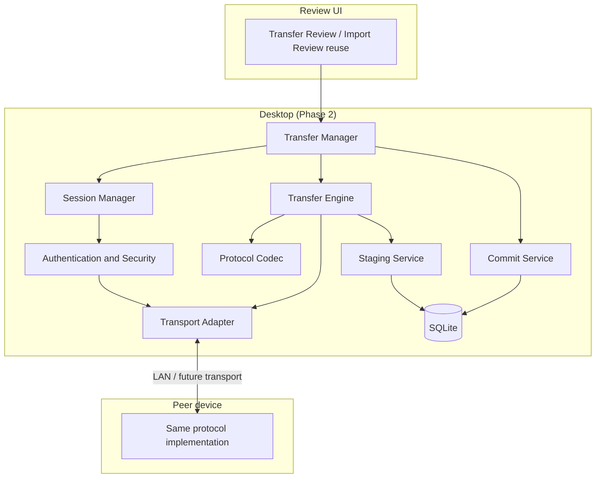

# Device Transfer — Architecture and Protocol

**Status:** Phase 1 design finalization — implementation not started.
**Scope:** Desktop implementation in Phase 2 behind a build-time feature flag.
Mobile integration follows once Mobile adopts the canonical schema.
**Authority:** This file owns transfer architecture, protocol, transport,
pairing, staging and review integration. It depends on `docs/schema.md`
(tables), `docs/rules.md` (conflict and financial rules) and `docs/SAFETY.md`
(staging, backup and cleanup rules).

Phase 1 implements nothing. No routes, IPC channels, QR code, network listener
or dependency is added in this phase.

---

## 1. Goals and non-goals

### Goals

- Transfer financial records between Desktop and Mobile in both directions.
- Work offline on a local network with no cloud account.
- Never require a cloud service.
- Never lose or silently overwrite a user's record.
- Make retries and interruptions safe.
- Keep the protocol independent of the transport so new transports can be
  added without redesigning the database or review flow.
- Exclude the feature completely from production builds when disabled.

### Non-goals

- Real-time collaborative editing or continuous sync.
- A server-hosted account system.
- Sending a live SQLite file.
- Sending financial records inside a QR code.
- Automatic conflict resolution without user review.
- Selecting a light-based transport technology in Phase 1. The adapter seam is
  defined; the mechanism is deliberately not chosen.

---

## 2. Architecture overview



### 2.1 Responsibilities

| Component | Responsibility | Must not do |
|---|---|---|
| **Transfer Manager** | Public entry point, lifecycle orchestration, feature-flag gate, coordinates session/engine/commit | Parse frames, write SQL, implement transport |
| **Session Manager** | Pairing, token issue/verify, session state, resume window, expiry, cleanup | Transfer records, compute financial totals |
| **Protocol Codec** | Versioned encode/decode, schema/capability negotiation, canonical JSON, checksums, typed errors | Store data or decide conflicts |
| **Transfer Engine** | Selection, batching, compression, ordering, acks, retry, resume, manifest integrity | Write canonical tables directly |
| **Transport Adapter** | Framing over a specific medium, connect/accept/send/close, peer metadata | Understand financial records or sessions |
| **Auth and Security** | TLS/keys, token hashing, HKDF, per-frame MAC, replay defence, secret cleanup | Persist raw tokens |
| **Staging Service** | Insert `transfer_staged_records`, validate, classify duplicates/conflicts, support review edits | Commit to canonical tables |
| **Commit Service** | Transactional apply of confirmed records, holdings rebuild, tombstones, audit | Skip validation or confirmation |
| **Review UI** | Show staged records, statuses, conflict detail, edit/skip/undo, confirm | Recompute financial formulas or talk to the transport |

The boundary is deliberate: a new transport replaces only the adapter; a new
category adds a codec schema and a staging validator; a new review surface
reuses the same staging records.

### 2.2 Module layout (Phase 2 target)

```text
backend/transfer/
  manager.py            # TransferManager
  sessions.py           # SessionManager
  protocol.py           # codec, versions, capabilities
  engine.py             # batching, acks, resume
  security.py           # TLS, tokens, HKDF, replay
  staging.py            # staging + validation
  commit.py             # transactional apply + holdings rebuild
  categories.py         # category registry and dependencies
  transports/
    base.py             # TransportAdapter protocol
    lan.py              # initial LAN adapter
    registry.py         # adapter registration
  routes.py             # only registered when the flag is enabled
  schemas.py            # Pydantic request/response models
```

The module is imported only behind the feature gate. When the flag is `0`, the
package is excluded from the sidecar and `routes.py` is never imported
(§12).

---

## 3. User workflows

### 3.1 Desktop → Mobile

1. Desktop user opens **Settings → Device Transfer → Send to device**.
2. Desktop creates a session (`desktop_to_mobile`) and displays a QR code and short pairing code.
3. Mobile scans the QR code or enters the short pairing code shown by Desktop.
4. Both devices perform `HELLO`/`HELLO_ACK`, authenticate, and negotiate
   protocol, schema and capabilities.
5. Desktop shows category selection (all or selected) and the estimated record
   count.
6. Desktop streams batches. Mobile validates and stages each batch as it
   arrives.
7. Mobile's review screen becomes usable before the last batch arrives.
8. The user reviews and confirms. Confirmed records are committed
   transactionally on Mobile.
9. Desktop shows per-batch acknowledgements and a final manifest result.
10. Either side can cancel; already-confirmed records remain committed.

### 3.2 Mobile → Desktop

1. Desktop creates a session (`mobile_to_desktop`) and displays a QR code.
2. Mobile scans it and selects **Send to Desktop**.
3. Mobile sends `OFFER` with its categories and counts.
4. Desktop validates and stages batches as they arrive.
5. Desktop's existing Import Review screen shows the staged records.
6. The user reviews and confirms; Desktop commits.
7. Desktop acknowledges the batches so Mobile can release its staging state.

The pairing UX is identical in both directions: **Desktop always displays the
QR code and hosts the session.** This keeps firewall/NAT behaviour predictable
and avoids Mobile having to run a listening server.

### 3.3 Resume

1. The connection drops mid-transfer.
2. The receiver keeps confirmed records and staged unconfirmed records.
3. The session enters `paused` and remains resumable until
   `expires_timestamp`.
4. The user reopens the session; Desktop displays a fresh QR code for the
   **same** `session_id` with a new short-lived pairing token.
5. Mobile rejoins; both sides exchange `RESUME_STATE` with the last committed
   and last staged batch ids.
6. The sender resends from the first unacknowledged batch.
7. Already-committed records are skipped by UUID + hash; already-staged records
   are not duplicated.

### 3.4 Replace

1. The user chooses **Replace** (advanced) instead of Smart Merge.
2. The user selects categories. The UI states exactly what will be replaced.
3. The receiver takes a verified pre-Replace snapshot and stores its path in
   `transfer_sessions.backup_path`.
4. After staging and validation, the receiver replaces all selected categories
   in one SQLite transaction: tombstone/delete selected local rows, apply the
   incoming records, and rebuild affected share and SIP summaries.
5. No selected category is partially replaced; unrelated categories are untouched.
6. Unrelated categories are untouched.
7. On any failure, the pre-Replace snapshot is restored and the failure is
   reported.

---

## 4. Pairing and security

### 4.1 QR payload

```text
finledge://pair
  ?v=1
  &sid=<session uuid>
  &h=<host or ip>
  &p=<port>
  &fp=<sha256 of the session certificate, first 16 bytes, base64url>
  &tk=<single-use pairing token, 32 random bytes, base64url>
  &tr=lan
  &exp=<unix seconds>
  &caps=<comma-separated capability names>
```

Rules:

- The QR contains **no financial records**, no amounts, no dates, no names.
- `tk` is a bearer credential for one pairing attempt. It is stored server-side
  only as `sha256(tk)`.
- `exp` is short: **120 seconds** from display.
- `fp` pins the session's TLS certificate so a LAN attacker cannot
  transparently proxy the connection.
- `tr` names the transport adapter (`lan` initially); the engine loads the
  matching adapter from the registry in §6.1.
- The QR is regenerated (new token, same `session_id`) for resume.

### 4.2 Pairing handshake

```text
Mobile                         Desktop
  |  connect (TLS, pin fp)         |
  |------------------------------->|
  |  HELLO {protocol, schema, caps, nonce_c} |
  |------------------------------->|
  |  HELLO_ACK {protocol, schema, caps, nonce_s, session_id, expires} |
  |<-------------------------------|
  |  AUTH {token, proof=HMAC(session_key, transcript)} |
  |------------------------------->|
  |  AUTH_OK {proof, resume_state} |
  |<-------------------------------|
```

- `session_key = HKDF-SHA256(token, salt = nonce_c || nonce_s, info = "finledge-transfer-v1")`.
- Every frame after `HELLO_ACK` carries `seq`, `session_id`, and
  `mac = HMAC-SHA256(session_key, header || payload)`.
- Replay protection: strictly increasing `seq` per direction; a repeated or
  lower `seq` is rejected; `nonce_c`/`nonce_s` are fresh per handshake.
- The token is accepted once. A second `AUTH` with the same token fails with
  `AUTH_FAILED`.
- Maximum 5 failed pairing attempts per session, then a 60-second lockout and a
  new QR requirement.
- Timestamps in `AUTH` must be within ±120 seconds of the receiver's clock;
  clock skew does not otherwise affect conflict resolution.

### 4.3 Transport encryption

- LAN adapter uses TLS 1.3 with an ephemeral self-signed certificate generated
  per session.
- The certificate fingerprint is pinned from the QR (`fp`).
- If a future transport cannot provide TLS, the adapter must declare
  `secure = False`, and the protocol uses application-level AEAD
  (AES-256-GCM) with the same `session_key`. A transport that cannot provide
  either is rejected for financial data.
- Compression happens **before** encryption (encrypt-then-send), never after.

### 4.4 Secret lifecycle

| Secret | Storage | Lifetime |
|---|---|---|
| Pairing token `tk` | SHA-256 hash in `transfer_sessions.resume_token_hash` | Until first successful auth or expiry |
| Session key | Memory only | Session lifetime |
| TLS private key | Memory only (ephemeral) | Session lifetime |
| Staged payloads | SQLite staging tables | Until commit, cancel or expiry |
| Logs | Never contain tokens, keys, amounts or descriptions | — |

On completion, cancellation, expiry or crash recovery, the manager clears the
in-memory keys and deletes temporary files. Staged rows are removed per §10.5.

---

## 5. Protocol

### 5.1 Versioning

- `protocol_version` is `major.minor`.
- Current: `1.0`.
- A receiver supports the same `major` and any `minor <= its own`.
- A sender advertises `min_protocol` and `max_protocol`.
- No compatible overlap → `VERSION_UNSUPPORTED`, with a human-readable
  "update FinLedge" message.
- `schema_version` is the sender's `PRAGMA user_version`. The receiver supports
  `min_schema <= sender_schema <= receiver_schema`. A newer schema is rejected
  with `SCHEMA_UNSUPPORTED`; it is never coerced.
- `capabilities` is a set: `categories`, `compression=zlib`, `hash=sha256`,
  `review=progressive`, `replace`, `resume`. Unknown optional capabilities are
  ignored; a required unknown capability causes rejection.

### 5.2 Framing

Every frame:

```text
4 bytes  big-endian payload length
1 byte   frame type
2 bytes  flags (bit 0 = zlib, bit 1 = binary payload)
N bytes  UTF-8 canonical JSON payload
```

Frame types:

| Type | Direction | Purpose |
|---|---|---|
| `HELLO` | both | Protocol/schema/capabilities, client nonce |
| `HELLO_ACK` | both | Server parameters, session id, expiry |
| `AUTH` | client | Token proof |
| `AUTH_OK` | server | Auth result, resume state |
| `OFFER` | sender | Categories, record counts, manifest hash |
| `SELECT` | receiver | Accepted categories |
| `BATCH_BEGIN` | sender | Batch id, category, count, checksum, first/last sequence |
| `RECORD` | sender | One canonical record payload |
| `BATCH_END` | sender | Batch checksum confirmation |
| `BATCH_ACK` | receiver | Durable staging confirmed |
| `RESUME_STATE` | both | Last committed / last staged batch |
| `COMMIT` | receiver | Confirmed record ids for a commit epoch |
| `COMMIT_ACK` | sender | Commit accepted and durable |
| `CANCEL` | both | Graceful cancellation |
| `ERROR` | both | Typed error |
| `PING` / `PONG` | both | Liveness |

### 5.3 Canonical record payload

```json
{
  "entity_type": "bank",
  "row_id": "3f2c...",
  "sequence_hint": 12,
  "created_timestamp": "2026-11-04T07:47:28.123456Z",
  "last_updated_timestamp": "2026-11-04T07:47:28.123456Z",
  "updated_device": "desktop-exe",
  "metadata_quality": "exact",
  "content_hash": "sha256:...",
  "business": {
    "txn_date": "2026-11-04",
    "category": "Interest Earned",
    "amount_scaled": 12345678,
    "description": "Example"
  }
}
```

- Money is sent as scaled integers; no floats.
Canonical share payloads use three entity types: `share` (`share_transactions`), `sip` (`sip_transactions`), and `dividend` (`dividend_events`). A `share` payload includes `transaction_type` (`ipo`/`buy`/`sell`), the **canonical share name**, `per_unit_price_scaled`, `quantity`, and `charge_scaled`; the local `share_id` is never sent. IPO status is never sent because it is derived from `quantity`: `NULL` = not allotted / result not entered, `> 0` = allotted, and blank/`0` is normalized to `NULL` before hashing and sending. A `sip` payload includes `investment_name`, `sip_plan_id`, `transaction_type` (`sip_installment`/`sip_redemption`), `amount_scaled`, `charge_scaled`, and `units`; `units` is `NULL` while an installment is pending and `NULL` as not applicable on a redemption. `amount_scaled` is the installment amount or the total **net** amount received on a full redemption. A `dividend` payload includes the canonical share name, `event_type` (`cash`/`bonus`), `cash_amount_scaled`, and `quantity`. `transaction_type`/`event_type` is immutable and included in the content hash. Every SIP plan has a separately generated UUID plus its SIP name, and each installment/redemption carries that UUID. `content_hash` uses the canonical share name, not `share_id`, so two devices agree even when their local UUIDs differ. Derived `share_holdings` and `sip_plan_summaries` are never sent as authority; the receiver rebuilds them from committed canonical events. On import the receiver resolves or creates a `shares` row by canonical name.
- `business` is the table's authoritative fields only.
- Unknown optional fields are preserved through commit in an extension payload. If the receiver cannot preserve a field, commit is blocked. Unknown required fields cause SCHEMA_UNSUPPORTED.
- The receiver recomputes `content_hash` and rejects a mismatch as
  `CHECKSUM_MISMATCH` at the record level (staged as invalid, batch not
  committed).

### 5.4 Batching

- Maximum batch: 500 records or 1 MiB uncompressed, whichever is smaller.
- A record never spans batches.
- `batch_id` is a UUID generated by the sender; retries reuse it.
- `sequence_no` inside a batch is the sender's per-table order.
- `BATCH_BEGIN.checksum` = SHA-256 of the concatenated canonical record
  payloads (sorted by `sequence_hint`, then `row_id`) in canonical JSON.
- The receiver recomputes the checksum before marking the batch `validated`.
- `BATCH_ACK` is sent only after the batch and all its records are durably
  staged in SQLite.
- The receiver acks cumulatively: acking batch `N` implies all batches before
  `N` in the same category are staged.
- Sender retries an unacked batch up to 3 times with exponential backoff
  (250 ms, 1 s, 4 s), then pauses the session.
- Compression: zlib level 6 if the payload exceeds 4 KiB and both sides
  advertise `compression=zlib`.

### 5.5 Manifest and final integrity

- `OFFER` includes a `manifest_hash` over the selection: categories, record
  counts, and the sorted `(entity_type, row_id, content_hash)` list.
- At completion, both sides compare the committed-subset manifest; the offered manifest separately covers the full selected set, so progressive confirmations do not produce a false mismatch.
- A mismatch fails the session with `INTEGRITY_MISMATCH`; already-committed
  records remain, and the user is shown which categories differ.

### 5.6 Error codes

| Code | Meaning | Recovery |
|---|---|---|
| `PAIRING_EXPIRED` | Token expired | Show a new QR |
| `AUTH_FAILED` | Bad token/proof, or token reused | New pairing |
| `VERSION_UNSUPPORTED` | No protocol overlap | Update the older device |
| `SCHEMA_UNSUPPORTED` | Sender schema outside supported range | Update the older device |
| `CAPABILITY_MISSING` | Required capability absent | Explain and stop |
| `CHECKSUM_MISMATCH` | Batch/record checksum failed | Resend batch; never commit it |
| `VALIDATION_FAILED` | Records invalid | Stage as invalid; user reviews |
| `STORAGE_FULL` | Receiver cannot write | Stop, keep confirmed records |
| `SESSION_EXPIRED` | Resume window elapsed | New session required |
| `CANCELLED` | User cancelled | Keep confirmed records |
| `INTERNAL` | Unexpected error | Log a code, not payloads |

Errors never include raw financial values in logs. The user-facing message may
name the category and count.

### 5.7 Timeouts and expiry

| Item | Value |
|---|---|
| Pairing token | 120 seconds |
| Handshake | 20 seconds |
| Idle session | 15 minutes |
| Resume window | 24 hours |
| Absolute session lifetime | 72 hours |
| Max pairing attempts | 5 per session |

Expiry is enforced by `transfer_sessions.expires_timestamp` and by the session
manager, not only by the client.

---

## 6. Transport abstraction

### 6.1 Adapter contract

```python
class TransportAdapter(Protocol):
    name: str                  # "lan", "optical", "relay"
    secure: bool               # True if the medium provides encryption
    def start(self, session) -> Endpoint: ...
    def accept(self, endpoint) -> Connection: ...
    def connect(self, endpoint, token) -> Connection: ...
    def send(self, connection, frame: bytes) -> None: ...
    def receive(self, connection) -> bytes: ...
    def close(self, connection) -> None: ...
    def describe(self) -> dict: ...
```

- The adapter moves opaque framed bytes. It never parses records.
- Adapters register in `transports/registry.py` under a name advertised in the
  QR/capabilities.
- The engine selects the adapter from the QR's transport name and the
  negotiated capability list.
- A new adapter is added by implementing the contract and registering it. No
  database, protocol, staging or review change is required.

### 6.2 LAN adapter (initial)

- Desktop listens on an ephemeral port bound to the private LAN interface(s).
- Mobile connects to the host/port in the QR.
- TLS 1.3 with the session certificate; fingerprint pinned.
- One connection per session; reconnect creates a new connection to the same
  session.
- No UPnP, no port forwarding, no internet exposure.
- If the device is not on the same LAN, the adapter reports
  `UNREACHABLE` and the user is told to use the same Wi-Fi.

### 6.3 Future adapters

| Adapter | Status | Notes |
|---|---|---|
| LAN/Wi-Fi | Phase 2 | Initial and required |
| Optical / light | Placeholder only | The user will supply a project later. This document deliberately does not choose a technology or message format |
| Cloud relay | Optional future | Must remain optional; no account required for LAN use |
| Other local | Future | Must implement the same adapter contract |

The protocol is transport-independent. A new adapter cannot change record
semantics, conflict rules or the database schema.

---

## 7. Categories, selection and dependencies

| Category key | Tables | Dependencies |
|---|---|---|
| bank | bank_transactions | None |
| personal_finance | personal_finance_entries | None (derived sync rows are not transferred) |
| share | share_transactions | Holdings rebuilt; shares one sequence counter with dividend events |
| sip | sip_transactions | SIP plan summaries rebuilt; no holdings change |
| dividend | dividend_events | Holdings rebuilt; bonus events change quantity; shares one sequence counter with share_transactions |
| transfers | transfers | None; PF balances are derived |
| shares | shares | Not a transfer category; the receiver resolves or creates the row from the canonical name carried by `share`/`dividend` payloads |
Rules:

- "All supported data" selects all six transfer categories. `shares` is not selected separately; it follows the `share`/`dividend` payloads.
- Selecting `share` or `dividend` implies resolving or creating the `shares` row by canonical name and rebuilding the affected share holdings on the receiver; selecting `sip` implies rebuilding the affected SIP plan summaries. The sender never sends `share_holdings` or `sip_plan_summaries` as authority.
- The receiver applies the same dividend/bonus holding validation as manual entry (`docs/rules.md` §7.12); an incoming event that lands on a zero holding is staged as invalid, never committed.
- Mobile has no `shares` table. Its payloads carry the canonical share name and Desktop resolves or creates the row; Desktop never sends `share_id` to Mobile.
- Derived PF rows are never transferred; they are recomputed from their source
  categories.
- Future categories (for example interest-rate tracking) are added to
  `categories.py` with their validation and dependency metadata; the protocol
  carries the key and the receiver stages unknown keys as `unsupported`.
- A category may not be selected if the receiver declares it unsupported.

---

## 8. Duplicate and conflict handling

Classification happens at staging time and is stored in
`transfer_staged_records.validation_status`:

| Condition | Status | Behaviour |
|---|---|---|
| UUID absent locally | `valid` | Eligible to commit |
| UUID present, same `content_hash` | `already_present` | Not inserted; shown as already synchronized |
| UUID present, different `content_hash` | `conflict` | Both versions shown; user chooses |
| No UUID match, similar business fields | `possible_duplicate` | Shown; user decides |
| Unknown category/field | `unsupported` | Shown; not committed |
| Invalid values/constraints | `invalid` | Shown with reason; not committed |

Rules:

- Never auto-overwrite on UUID + different content.
- Never auto-reject a possible duplicate.
- Timestamps are supporting evidence, not truth. The UI shows both devices'
  timestamps and says the clocks may differ.
- The existing deterministic merge ranking
  `(last_updated_timestamp, updated_device, content_hash)` may be shown as a
  suggestion ("incoming looks newer"), but the user confirms.
- A tombstone with a newer `deleted_timestamp` prevents resurrection; the UI
  explains that the record was deleted on another device.
- `record_conflicts` stores the losing version when the merge is automatic
  (import/export path). Transfer review stores both versions in staging until
  the user decides.
- The entity type is part of identity and of conflict classification. `share`,
  `sip`, and `dividend` are separate tables, so an incoming `sip` record can
  never match a local `share` record even when the business fields look similar;
  the review UI groups and labels rows by entity type and shows the missing or
  differing type explicitly. A same-UUID match is only meaningful within the
  same entity type.
- For `share` and `dividend` rows, cross-device share identity is the canonical
  share **name**, not `share_id`. A different local `share_id` for the same name
  is not a conflict; the receiver resolves the local `shares` row by name.
  `share_id` never appears in the payload or `content_hash`.

---

## 9. Staging and review integration

### 9.1 Staging

For each received record:

1. Validate the envelope and recompute the hash.
2. Validate the category-specific business rules using the same service
   validators as manual entry, including the dividend/bonus holding replay in
   `docs/rules.md` §7.12 and the share-name normalization in §7.11.
3. Classify against local data (§8).
4. Insert into `transfer_staged_records` with `payload_json`.
5. Make the record visible to the review UI immediately.

A batch is `validated` only when every record is inserted and the checksum
matches. A batch with any failed insert is `incomplete` and none of its records
are eligible for commit.

### 9.2 Reuse of Import Review

Reuse `frontendwebapp/src/pages/ImportReview.jsx` and its card structure:

- A new `source="device-transfer"` mode backed by
  `GET /device-transfer/sessions/{id}/staged`.
- The existing `REVIEW_FIELDS` map supplies compact per-category fields.
- Compact row shows: category, date, amount, and New / Exact duplicate / Possible duplicate / Conflict / Invalid status, including the local record involved.
  (`New`, `Present`, `Duplicate?`, `Conflict`, `Invalid`).
- Expand shows: full field comparison for conflicts, source device, both
  timestamps, and the validation detail.
- Actions: keep mine, take theirs, keep both, skip, edit, undo, and expand. Bulk decisions may apply to a selected group. Review ordering is explicit for same-day Share Portfolio events. Reorder is allowed only within the
  staged commit order; it does not change canonical identity.
- A small notice states that "already present" records will not be inserted.
- Confirmation is explicit and disabled while no valid records remain.

For each row, the receiver offers keep mine, take theirs, keep both, or skip; bulk decisions may be applied to a selected group. Classification includes exact duplicate, possible duplicate, conflict, and the matching local record.

The UI must not show raw hashes, UUIDs, protocol versions or stack traces by
default. Those belong behind a details disclosure for support.

### 9.3 Editing and deleting staged records

- Editing writes `edited_payload_json`; `payload_json` is preserved for audit.
- "Delete" marks `review_decision='skip'`; it is reversible (undo) and does not
  remove the staged row.
- Edits are re-validated; an edit that becomes invalid cannot be confirmed.
- Confirming applies `edited_payload_json` when present, otherwise
  `payload_json`.

### 9.4 Confirmation

- Confirmation is per commit epoch: the set of staged records the user has
  accepted so far.
- The receiver applies the accepted commit epoch in one SQLite transaction,
  then rebuilds affected share and SIP summaries before commit.
- `sequence_no` is assigned by the **receiver**: Smart Merge appends accepted
  records in staged order after the current maximum for that table; Replace
  assigns `1..N` in sender order. The sender's `sequence_hint` is advisory and
  is never trusted as a local key.
- `committed_timestamp` is set; the staged rows remain until session cleanup
  for audit.
- A failure rolls back the whole epoch; already-committed epochs remain.

---

## 10. Progressive transfer and resume

### 10.1 State machine

```text
pairing
  -> active
      -> receiving (batches arriving)
      -> reviewing (user confirming)
      -> receiving (more batches)
  -> paused (interruption)
      -> active (resume)
  -> completed
  -> cancelled
  -> expired
  -> failed
```

### 10.2 Progressive rules

- A record is available in the review UI as soon as its batch is durably
  staged.
- The user may confirm while later batches are still arriving.
- Confirmed records are safe even if the connection then drops.
- Unconfirmed records remain staged.
- A batch is never committed before validation.
- A corrupted or truncated batch is never committed.
- Idempotency: `UNIQUE(session_id, entity_type, row_id)` plus the canonical
  UUID check means replaying a committed record is a no-op.
- `transfer_batches.state` is the durable proof of what was received,
  validated and committed.

### 10.3 Resume protocol

1. Reconnect to the same `session_id` with a fresh token.
2. Exchange `RESUME_STATE {last_committed_batch, last_staged_batch}`.
3. Sender skips batches with `sequence_no <= last_staged_batch` in each
   category.
4. Receiver verifies the manifest subset for skipped batches using stored
   hashes.
5. If a skipped batch is missing or its checksum cannot be verified, the sender
   resends it.
6. Commit resumes from the first uncommitted record.

### 10.4 Partial confirmation interaction

- Committing a subset does not close the session.
- `last_committed_batch` advances only over contiguous fully-staged batches;
  gaps keep later batches uncommitted.
- If the user confirms batch 3 but batch 2 is still incomplete, batch 3's
  records are staged but not committed until batch 2 is resolved or explicitly
  skipped. This prevents silent data gaps.
- The UI shows "waiting for an earlier batch" rather than committing out of
  order.

### 10.5 Session cleanup

| Event | Effect |
|---|---|
| Completed | Keep session row and audit; delete staged payloads after 7 days |
| Cancelled | Delete staged rows and temp files immediately; keep a small audit row |
| Expired | Delete staged rows and temp files; keep the session row for diagnosis |
| Failed | Keep staged rows for the resume window; allow retry |
| Crash | On startup, mark `active` sessions with no live connection as `paused`; expire per policy |

Cleanup never deletes canonical transaction rows.

---

## 11. Smart Merge and Replace

### 11.1 Smart Merge (default)

- Add genuinely new records.
- Classify same-UUID records as already present or conflict.
- Classify similar different-UUID records as possible duplicates.
- Preserve all unrelated local data.
- Require review and explicit confirmation.
- Never silently choose a winner for a conflict.

### 11.2 Replace (advanced)

- Only explicitly selected categories, committed together atomically.
- Typed confirmation plus a verified backup.
- Never wipes unrelated categories.
- Deletes selected-category rows with tombstones, then applies incoming rows.
- Rebuilds holdings for affected share names.
- Restores the pre-Replace snapshot on failure; no selected category is left
  partially replaced.
- Stores the backup path in `transfer_sessions.backup_path`.

### 11.3 Related-record handling

| Replaced category | Related action |
|---|---|
| `bank` | None; derived PF rows recompute automatically |
| `personal_finance` | None; transfers remain |
| `share` | Rebuild holdings for every affected share |
| `sip` | No holdings change; SIP outstanding is derived from the transferred rows |
| `dividend` | Rebuild holdings (bonus changes quantity) |
| `transfers` | None; PF balances recompute automatically |

---

## 12. Build-time feature flag

### 12.1 Variable

```text
FINLEDGE_ENABLE_DEVICE_TRANSFER=0|1
```

- Code default when the variable is absent in development: `0` (disabled).
- Development may set `1` in the root `.env` or shell.
- Testing EXE/AppX may set `1` explicitly for a test build.
- Production build scripts force `0`, overriding any ambient value. They **fail closed**
  if the variable is unset rather than silently assuming a value: a missing value stops
  the production build.
- Mobile has its own build flag (`VITE_FINLEDGE_ENABLE_DEVICE_TRANSFER`)
  once its integration exists; it must also default to off in production.

### 12.2 Why build time, not runtime

A runtime flag only hides UI; the routes, IPC channels, preload APIs and
backend package would still exist and could be reached by a crafted request or
DevTools. That fails the requirement. The flag is therefore resolved during the
build and the disabled code is **removed**, not branched around at runtime.

### 12.3 Frontend

In `frontendwebapp/vite.config.js`:

```js
import { defineConfig, loadEnv } from "vite";

export default defineConfig(({ mode }) => {
  const env = loadEnv(mode, process.cwd(), "");
  const enableDeviceTransfer =
    String(env.FINLEDGE_ENABLE_DEVICE_TRANSFER ?? "0").trim() === "1";

  return {
    define: {
      __FINLEDGE_ENABLE_DEVICE_TRANSFER__: JSON.stringify(enableDeviceTransfer),
    },
    plugins: [
      // When disabled, alias the transfer entry to an empty stub so the
      // transfer components and dependencies are not emitted.
      deviceTransferExclusionPlugin(enableDeviceTransfer),
    ],
  };
});
```

- `features.js` exports `DEVICE_TRANSFER_ENABLED = __FINLEDGE_ENABLE_DEVICE_TRANSFER__`.
- `App.jsx` registers the route only inside a statically-false branch; the
  build's dead-code elimination removes it.
- The Settings entry is rendered only inside the same branch.
- The Transfer page and its API module are not imported when disabled.
- No secret is placed in a `VITE_*` variable. The flag is a boolean, not a
  credential.

### 12.4 Electron main and preload

- Generate `desktop/generated/featureFlags.js` at build time with
  `module.exports = { ENABLE_DEVICE_TRANSFER: false }`.
- `main.js` requires the transfer IPC module only inside
  `if (ENABLE_DEVICE_TRANSFER) { ... }`.
- `preload.js` exposes `window.finledge.transfer` only inside the same
  compile-time branch.
- Package the transfer directory only when enabled:
  - `electron-builder` `files` includes `desktop/transfer/**` only for enabled
    builds, or
  - the build bundles `main.js`/`preload.js` with esbuild `define` and
    tree-shaking, so disabled imports are not emitted.
- The production packaging step must fail if the flag is missing or not `0`.

### 12.5 Python backend / PyInstaller

- `backend/feature_flags.py` is generated at build time:
  `DEVICE_TRANSFER_ENABLED = False`.
- `backend/main.py` imports and registers the transfer router only when the
  constant is true.
- `desktop/scripts/build-sidecar.ps1` passes `--exclude-module backend.transfer`
  (and its submodules) when disabled.
- The sidecar build uses the same flag value as the frontend and Electron
  build; a mismatch fails the build.
- No transfer-only dependency is installed into the production bundle when
  disabled.

### 12.6 Verification (must run in Phase 2)

1. Build production with `FINLEDGE_ENABLE_DEVICE_TRANSFER=0`.
2. `grep -R "device-transfer\|DeviceTransfer\|transfer_sessions"` over
   `desktop/dist`, the packaged `resources`, and the sidecar → no match.
3. `npx asar list` the packaged app → no transfer files.
4. Inspect the PyInstaller archive → no `backend.transfer` modules.
5. Start the packaged app → `GET /device-transfer/status` returns HTTP 404.
6. In DevTools, `window.finledge.transfer` is `undefined`.
7. Enumerate IPC channels → no transfer channels.
8. Build with `1` and verify the feature works end to end on the LAN.
9. Confirm production build scripts fail closed if the variable is unset.

### 12.7 Environment matrix

| Build | Flag | Behaviour |
|---|---|---|
| Development | `0` by default; explicitly set `1` to test | Full feature when enabled |
| Testing EXE | From the build environment | Configurable |
| Testing AppX | From the build environment | Configurable |
| Production EXE | Forced `0` | Absent |
| Production AppX | Forced `0` | Absent |
| Mobile development | `1` when enabled | Full feature after schema adoption |
| Mobile production | Forced `0` until release approval | Absent |

---

## 13. Version compatibility

| Scenario | Behaviour |
|---|---|
| Older Desktop ↔ current Desktop | Older advertises a lower minor; current accepts. Missing capabilities are disabled |
| Current ↔ future Desktop | Future advertises a higher minor; current accepts the shared subset. Unknown optional fields preserved or block commit |
| Current ↔ future schema | Reject `SCHEMA_UNSUPPORTED`; never coerce |
| Older schema ↔ current | Accept if `>= min_schema`; map known fields; unknown required fields reject |
| Unknown category | Stage `unsupported`, show the user, do not commit |
| Unknown optional field | Preserve through commit or block the record; never silently discard |
| Required capability missing | Reject with a clear message |
| Different app versions | Allowed if protocol/schema ranges overlap |

Rules:

- Negotiation happens before any record is sent.
- A rejected transfer sends no financial data.
- The receiver never writes a record it cannot validate under its schema.
- After a schema upgrade, old staged payloads are re-validated before commit;
  if they no longer validate, they are shown as invalid.

---

## 14. Phase 2 Desktop implementation checklist

### Foundation

- [ ] Add `FINLEDGE_ENABLE_DEVICE_TRANSFER` to `.env.example` and
      `docs/desktop-environment.md`.
- [ ] Implement the build-time flag in Vite, Electron main/preload, packaging
      and the sidecar, including the production fail-closed check.
- [ ] Create `backend/transfer/` with the module boundaries in §2.2.
- [ ] Add `TransferManager` as the only public entry point.

### Session and security

- [ ] `SessionManager`: create, pair, authenticate, pause, resume, expire,
      cancel, clean up.
- [ ] QR payload generation for both directions (Desktop always displays).
- [ ] Token hashing, single use, 120-second expiry, attempt limiting.
- [ ] TLS certificate generation and fingerprint pinning.
- [ ] HKDF session key, per-frame HMAC, sequence replay defence.
- [ ] Secret and temp-file cleanup on every exit path.

### Protocol and engine

- [ ] `ProtocolCodec`: framing, canonical JSON, version and capability
      negotiation, typed errors.
- [ ] `TransferEngine`: selection, batching (500 / 1 MiB), zlib, checksums,
      acks, retry, resume, manifest.
- [ ] `RESUME_STATE` and idempotent replay.
- [ ] Transport registry and `LanTransport`.
- [ ] Adapter tests proving a mock adapter needs no protocol changes.

### Staging and review

- [ ] `StagingService`: insert, validate, classify, edit, skip, undo.
- [ ] `GET /device-transfer/sessions/{id}/staged`.
- [ ] `PATCH /device-transfer/staged/{id}` for edits/decisions.
- [ ] `POST /device-transfer/sessions/{id}/commit`.
- [ ] Reuse `ImportReview.jsx` with `source="device-transfer"`.
- [ ] Compact status + expandable detail; conflict comparison.
- [ ] Progressive visibility while batches arrive.

### Commit

- [ ] `CommitService`: per-category transaction, holdings rebuild, tombstones,
      conflict records.
- [ ] `transfer_batches.state` transitions and idempotency.
- [ ] Smart Merge and Replace paths.
- [ ] Pre-Replace backup and restore on failure.
- [ ] Manifest verification.

### Safety and verification

- [ ] Session cleanup and staged-row retention.
- [ ] Interrupted transfer tests.
- [ ] Checksum tamper tests.
- [ ] Production build exclusion verification (§12.6).
- [ ] LAN end-to-end test on two devices.
- [ ] No transfer endpoint, IPC channel or preload API in production.

---

## 15. Mobile integration plan

Mobile integration is **not** part of Phase 2 desktop scope, but the
architecture is designed for it:

1. Adopt the canonical schema (`docs/schema.md` §10).
2. Implement the same protocol codec and session state machine in the Mobile
   service layer.
3. Add a QR scanner for pairing.
4. Add staging tables with the same shape.
5. Reuse the Mobile import-review UI.
6. Add the Mobile build flag.
7. Run the shared protocol fixture suite against Desktop.
8. Add LAN end-to-end tests on Android.

Until Mobile adopts the canonical schema, its transfers are rejected with
`SCHEMA_UNSUPPORTED` rather than coerced from the old FIFO/split-table model.

---

## 16. Test strategy

| Layer | Tests |
|---|---|
| Protocol codec | Round-trip every frame; unknown fields; bad versions; truncated frames |
| Security | Token single use, expiry, replay, wrong fingerprint, tampered MAC |
| Session | Create, pair, pause, resume, expire, cancel, cleanup |
| Batching | Limits, checksums, retry, cumulative ack, gap handling |
| Staging | Validation per category, duplicate/conflict classification, edits |
| Commit | Atomicity, rollback, holdings rebuild, tombstones, idempotency |
| Replace | Selected categories only, backup, restore on failure |
| Resume | Drop mid-batch, drop between batches, partial confirmation |
| Manifest | Success, mismatch, missing category |
| Adapter | Mock adapter proves transport independence; LAN adapter integration |
| Feature flag | Enabled build works; disabled build has no route/IPC/preload/package |
| Performance | 10k records: throughput, memory, staging latency, review responsiveness |

Test data is synthetic and lives in per-test temporary directories
(`docs/SAFETY.md` Part 1 §4). No test touches real data.

---

## 17. Risks and open decisions

| # | Risk / decision | Mitigation / status |
|---|---|---|
| 1 | LAN discovery/firewall differences across Windows and Android | Use the QR host/port; no discovery dependency; clear unreachable message |
| 2 | Clock skew misleads conflict suggestions | Timestamps are advisory; UUID + hash drive classification |
| 3 | Large transfers exhaust memory or disk | Batching, streaming, staging in SQLite, disk-space preflight |
| 4 | Optical transport unknown | Adapter seam only; no technology chosen |
| 5 | Cloud relay scope creep | Explicitly optional; no account required |
| 6 | Production flag accidentally enabled | Fail-closed build scripts plus §12.6 verification |
| 7 | Mobile schema still divergent | Reject with `SCHEMA_UNSUPPORTED` until adoption |
| 8 | Session cleanup deletes unconfirmed data | Staged rows retained for the resume window; cleanup never touches canonical rows |
| 9 | Conflict UI overwhelming | Compact status by default, details on expand |
| 10 | Transfer of derived PF rows | Derived rows are never sent; recomputed locally |
| 11 | `share_holdings` divergence after transfer | Full rebuild for affected shares (resolved by canonical name) on commit |
| 12 | Token leakage through logs | Logging policy forbids payloads/tokens; tests assert it |

Open decisions that Phase 2 must record before implementation:

- Whether Mobile production enables transfer at launch or after a beta.
- Whether Replace mode is exposed in Phase 2 or deferred to Phase 3.
- Whether a session may be resumed from a different Mobile device (current
  design: no; the peer device id must match).
- Exact retention for committed staged rows (proposed: 7 days).

---

## 18. Cross-references

- `docs/schema.md` — `transfer_sessions`, `transfer_batches`,
  `transfer_staged_records`, `deleted_records`, `record_conflicts`.
- `docs/rules.md` — UUID, hash, conflict classification, Smart Merge/Replace.
- `docs/SAFETY.md` — staging safety, backup, cleanup, encryption, incident
  response.
- `docs/desktop-tasks.md` — Phase 2 task list and completion evidence.
