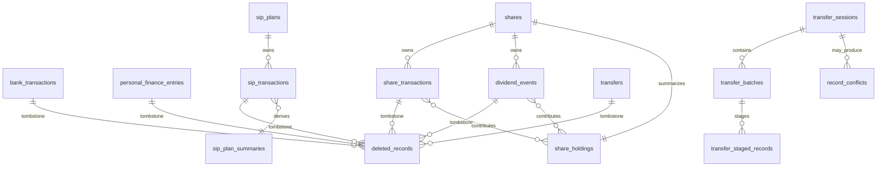

# Schema — Unified Canonical SQLite (Desktop + Mobile)

**Status:** Phase 1 design — implementation not started. Approved architectural decisions are recorded here; explicitly marked proposals remain subject to user approval.
**Authority:** This file is the single source of truth for the financial data
model. `docs/rules.md` defines behaviour; `docs/SAFETY.md` defines safety;
`docs/device-transfer.md` defines the transfer protocol. If code and this file
disagree during Phase 2, code is wrong until this file is deliberately changed
through the *Decision changes* log in `docs/desktop-tasks.md`.

Phase 1 produces documentation and reviewed DDL text only. **Nothing in this
file is executed in Phase 1**, no database file is created, and no application
behaviour changes.

---

## 1. Scope and platform strategy

One logical schema serves both platforms:

| Platform | Runtime | Physical storage | Schema |
|---|---|---|---|
| Desktop | Electron + React + Python/FastAPI | Per-environment data folder (see §11) | Canonical, SQLite via stdlib `sqlite3` |
| Mobile | Capacitor WebView + local service layer | App-private `Directory.Data` | Current legacy schema remains unchanged in this Desktop migration; canonical adoption is a separate future task |

The approved target model is shared for a future Mobile migration. The two
platforms may differ in UI, packaging, process model and storage paths. This
Desktop migration does not change Mobile code or schema. The current Mobile schema
(`id INTEGER PRIMARY KEY AUTOINCREMENT`, `REAL` amounts, split
`personal_finance_bank_flow` / `personal_finance_cash_flow`) is an **early
implementation** and is explicitly superseded by this document; see §10.

The canonical model is offline-first:

- SQLite is the source of truth on every device.
- No network call is required to create, edit, delete, summarise or export.
- Device transfer is an optional transport layered on top, never a dependency.

---

## 2. Conventions

### 2.1 Identifiers

- Table and column names are `snake_case`.
- Every writable transaction table has `row_id TEXT PRIMARY KEY` holding a
  canonical lowercase UUID string (`8-4-4-4-12`).
- `row_id` is permanent transaction identity. It is never regenerated on edit,
  never reused, and never derived from business fields alone.
- A second monotonic ordering column, `sequence_no INTEGER NOT NULL`, preserves
  physical/workbook order. It is not identity.

### 2.2 Dates and timestamps

- `txn_date TEXT NOT NULL` is a local calendar date, `YYYY-MM-DD`. A calendar
  date is financially meaningful (it is what the user entered and what appears
  in Excel) and is never converted to UTC.
- `created_timestamp` and `last_updated_timestamp` are canonical UTC
  timestamps: `YYYY-MM-DDTHH:MM:SS.ffffffZ` (always 6 fractional digits,
  always `Z`, fixed width so lexical and chronological order agree).
- Legacy timestamps are preserved, not shifted. See §9.4 and
  `docs/rules.md` §3.
- `metadata_quality` records how a legacy timestamp was obtained:
  `exact` | `legacy_offset` | `legacy_naive` | `legacy_date_only` |
  `backfilled` | `imported_missing`.

### 2.3 Money, prices, quantities, rates

All exact numeric values are stored as scaled `INTEGER`:

| Kind | Column suffix / type | Scale | Example |
|---|---|---|---|
| Currency amounts, charges, proceeds, cost, profit | `*_scaled INTEGER` | 10⁴ | NPR 1,234.5678 → `12345678` |
| Per-unit prices | `per_unit_price_scaled INTEGER` | 10⁴ | 123.45 → `1234500` |
| Rates / percentages | `*_ppm INTEGER` (reserved) | 10⁶ | 5.25% → `52500` |
| Share quantities | `quantity INTEGER` | whole shares | 10 → `10` |

`REAL` is never used for money, prices or rates. `TEXT` is never used for
canonical numeric storage. Python uses `Decimal` for all financial arithmetic;
the JavaScript port uses an equivalent exact-decimal representation, not
binary floats. See §7.

### 2.4 Derived values

A column is either **authoritative** (stored, source of truth) or **derived**
(computed from authoritative values). Derived values are not stored unless the
schema explicitly says so, and they are never edited directly. Derived fields
are excluded from `content_hash`. See §5.

### 2.5 Content hash

- `content_hash TEXT NOT NULL`, formatted `sha256:<64 lowercase hex>`.
- It is a change/integrity detector, **not** identity.
- Existing SHA-1 values (`40` hex characters, no prefix) are recognised on
  import, verified, and replaced by the canonical SHA-256 value. See §9.5.
- The hash input is the canonical business payload, not the row's metadata or
  derived values.

---

## 3. Entity map



`shares` is a master identity table, not a financial event. `sip_plans` is a
proposed master identity table (§4.3.4) and is not part of the approved design
until the user approves it. `share_holdings` and `sip_plan_summaries` are derived
caches, not independent financial ledgers. `deleted_records` and
`record_conflicts` are audit tables. `transfer_*` tables exist only while a
transfer session is active or awaiting cleanup; they contain no authoritative
financial data.

---

## 4. Tables

Every table below lists authoritative fields, derived fields, constraints and
indexes. DDL is documentation text and must not be executed in Phase 1.

> **Superseded 2026-11-06 — a `shares` master table is added.** The text below
> recorded the earlier decision that there is no `shares` dimension table. That
> decision is reversed. A share name stored as free text on every transaction row
> has no parent row, so no foreign key can guarantee that a dividend or bonus
> event belongs to a real share. `shares` (§4.3.3) now owns the canonical name;
> `share_transactions` and `dividend_events` reference it by `share_id`, and
> `share_holdings` is keyed by `share_id`. The transfer support tables keep their
> existing foreign keys.
>
> **Old text (kept for the record):** "There is deliberately no `shares` dimension
> table. A share is identified by its normalised name, which is what the workbook,
> the user and every existing summary use; adding a surrogate key would duplicate
> the name and create a second identity to keep in sync. `share_holdings` uses that
> normalised name as its `share_name COLLATE NOCASE` key. Foreign keys are therefore
> limited to the transfer support tables, where cascade behaviour is real
> (`transfer_sessions` → `transfer_batches` → `transfer_staged_records`)."

### 4.1 `bank_transactions`

**Purpose:** Bank Services income and expense entries. One row per bank
transaction. Mirrors `bank_transactions.xlsx` → `Bank`.

**Source of truth for:** date, category, amount, description, identity and
metadata. **Not** source of truth for cumulative amount.

| Column | Type | Null | Notes |
|---|---|---|---|
| `row_id` | TEXT | no | UUID PK |
| `sequence_no` | INTEGER | no | 1-based insertion order, unique |
| `txn_date` | TEXT | no | `YYYY-MM-DD` |
| `category` | TEXT | no | Validated against the shared bank category registry |
| `amount_scaled` | INTEGER | no | Signed amount ×10⁴ |
| `description` | TEXT | yes | Empty stored as `NULL` |
| `created_timestamp` | TEXT | no | UTC µs |
| `last_updated_timestamp` | TEXT | no | UTC µs |
| `updated_device` | TEXT | no | Device label |
| `metadata_quality` | TEXT | no | Default `exact` |
| `content_hash` | TEXT | no | `sha256:…` |

**Derived, never stored:** `cumulative_amount` (running sum over
`sequence_no`), summary totals, category breakdowns, dashboard series.

Why cumulative is not stored: the current Excel implementation recomputes it
after every edit and delete (`_recompute_bank_sheet`) and appends
`previous + amount`; storing it in SQLite would recreate a redundant value that
can drift and would force a full-table rewrite on a backdated edit. It is
computed on read/export with a window function (§6.1).

```sql
CREATE TABLE bank_transactions (
    row_id                 TEXT    PRIMARY KEY,
    sequence_no            INTEGER NOT NULL,
    txn_date               TEXT    NOT NULL,
    category               TEXT    NOT NULL,
    amount_scaled          INTEGER NOT NULL,
    description            TEXT,
    created_timestamp      TEXT    NOT NULL,
    last_updated_timestamp TEXT    NOT NULL,
    updated_device         TEXT    NOT NULL,
    metadata_quality       TEXT    NOT NULL DEFAULT 'exact',
    content_hash           TEXT    NOT NULL,
    CHECK (length(row_id) = 36),
    CHECK (txn_date GLOB '[0-9][0-9][0-9][0-9]-[0-9][0-9]-[0-9][0-9]'),
    CHECK (sequence_no > 0),
    CHECK (updated_device IN ('desktop-exe','desktop-appx','desktop-dev','desktop-test','mobile','legacy')),
    CHECK (metadata_quality IN ('exact','legacy_offset','legacy_naive','legacy_date_only','backfilled','imported_missing')),
    CHECK (content_hash LIKE 'sha256:%'),
    CHECK (category <> '')
);
CREATE UNIQUE INDEX ux_bank_sequence ON bank_transactions(sequence_no);
CREATE INDEX ix_bank_date       ON bank_transactions(txn_date, sequence_no);
CREATE INDEX ix_bank_category   ON bank_transactions(category, txn_date);
CREATE INDEX ix_bank_updated    ON bank_transactions(last_updated_timestamp);
```

**Lifecycle:** created by the service layer, edited in place (same `row_id`,
same `sequence_no`), deleted by tombstone + physical delete in one
transaction. Deletion never renumbers other rows.

---

### 4.2 `personal_finance_entries`

**Purpose:** Manually entered Personal Expenses rows for both Bank Flow and
Cash Flow. One table, distinguished by `flow_type`. Separate screens and
separate Excel exports remain.

**Not stored here:** read-only `bank-services-sync` and `share-sync` rows
derived from other modules; transfer rows (see `transfers`). Those are produced
at query time with the same read-only semantics as today (§6.3).

| Column | Type | Null | Notes |
|---|---|---|---|
| `row_id` | TEXT | no | UUID PK |
| `sequence_no` | INTEGER | no | Insertion order within the table |
| `txn_date` | TEXT | no | `YYYY-MM-DD` |
| `flow_type` | TEXT | no | `bank` or `cash` |
| `direction` | TEXT | no | `income` or `expense` |
| `category` | TEXT | no | Validated against the shared PF category registry |
| `amount_scaled` | INTEGER | no | Absolute amount ×10⁴, `> 0` |
| `signed_amount_scaled` | INTEGER | no | `+amount` for income, `−amount` for expense |
| `description` | TEXT | yes | |
| `created_timestamp` | TEXT | no | UTC µs |
| `last_updated_timestamp` | TEXT | no | UTC µs |
| `updated_device` | TEXT | no | Device label |
| `metadata_quality` | TEXT | no | Default `exact` |
| `content_hash` | TEXT | no | `sha256:…` |

```sql
CREATE TABLE personal_finance_entries (
    row_id                 TEXT    PRIMARY KEY,
    sequence_no            INTEGER NOT NULL,
    txn_date               TEXT    NOT NULL,
    flow_type              TEXT    NOT NULL,
    direction              TEXT    NOT NULL,
    category               TEXT    NOT NULL,
    amount_scaled          INTEGER NOT NULL,
    signed_amount_scaled   INTEGER NOT NULL,
    description            TEXT,
    created_timestamp      TEXT    NOT NULL,
    last_updated_timestamp TEXT    NOT NULL,
    updated_device         TEXT    NOT NULL,
    metadata_quality       TEXT    NOT NULL DEFAULT 'exact',
    content_hash           TEXT    NOT NULL,
    CHECK (length(row_id) = 36),
    CHECK (txn_date GLOB '[0-9][0-9][0-9][0-9]-[0-9][0-9]-[0-9][0-9]'),
    CHECK (sequence_no > 0),
    CHECK (flow_type IN ('bank','cash')),
    CHECK (direction IN ('income','expense')),
    CHECK (amount_scaled > 0),
    CHECK (signed_amount_scaled = CASE WHEN direction = 'income' THEN amount_scaled ELSE -amount_scaled END),
    CHECK (updated_device IN ('desktop-exe','desktop-appx','desktop-dev','desktop-test','mobile','legacy')),
    CHECK (metadata_quality IN ('exact','legacy_offset','legacy_naive','legacy_date_only','backfilled','imported_missing')),
    CHECK (content_hash LIKE 'sha256:%'),
    CHECK (category <> '')
);
CREATE UNIQUE INDEX ux_pf_sequence ON personal_finance_entries(sequence_no);
CREATE INDEX ix_pf_flow_date       ON personal_finance_entries(flow_type, txn_date, sequence_no);
CREATE INDEX ix_pf_category        ON personal_finance_entries(flow_type, category, txn_date);
CREATE INDEX ix_pf_updated         ON personal_finance_entries(last_updated_timestamp);
```

**Signed amount:** stored for query simplicity, but constrained to agree with
`direction`; the service computes both from one input so they cannot diverge.
No SQL trigger is needed.

**Lifecycle:** same as Bank. Editing a row never changes `row_id` or
`sequence_no`. Deleting writes a tombstone.

---

### 4.3 Share canonical event tables

Three canonical event tables replace the single legacy Excel `Share` worksheet. They are partitioned by financial semantics, not by UI screen:

| Table | Holds | Sequence scope |
|---|---|---|
| `share_transactions` | IPO application/allotment, secondary buy, secondary sell | Shared with `dividend_events` |
| `sip_transactions` | SIP installments, SIP full redemption | Own counter |
| `dividend_events` | Cash dividend, bonus shares | Shared with `share_transactions` |

The split is deliberate. A single combined table would need a long CHECK to keep two different row shapes apart, and roughly half of its columns would be `NULL` on every row. SIP is also excluded from the share holdings and P/L replay, so SIP rows never need to be ordered against share rows. Combined name suggestions and the combined history list are read-only UNION views (§6.2), not a second writable table.

#### 4.3.1 `share_transactions`

**Purpose:** IPO application/allotment, secondary purchases, and secondary sales. These share the holding/cost rules and one replay order with bonus events.

**Status:** Approved canonical source-of-truth table.

**Creation order:** `shares` (§4.3.3) is created before `share_transactions` and
`dividend_events` in the migration, because both reference it. This section keeps
its earlier number so existing references stay valid.

| Column | Type | Null | Notes |
|---|---|---|---|
| `row_id` | TEXT | no | UUID PK |
| `sequence_no` | INTEGER | no | Same-day replay order; shares one counter with `dividend_events` |
| `txn_date` | TEXT | no | `YYYY-MM-DD` |
| `share_id` | TEXT | no | FK → `shares(share_id)`; display name comes from `shares.name` |
| `transaction_type` | TEXT | no | `ipo`, `buy`, `sell`; immutable |
| `per_unit_price_scaled` | INTEGER | no | Unit price ×10⁴, `>= 0` |
| `quantity` | INTEGER | yes | Allotted shares for IPO; whole shares for buy/sell. For IPO: `NULL` = not allotted / result not entered; `> 0` = allotted. `0` is normalized to `NULL` and rejected by the CHECK |
| `charge_scaled` | INTEGER | no | Charge ×10⁴, `>= 0`, default `0`; secondary buy/sell default `0`; IPO application charge preserved |
| `created_timestamp` | TEXT | no | UTC µs |
| `last_updated_timestamp` | TEXT | no | UTC µs |
| `updated_device` | TEXT | no | Device label |
| `metadata_quality` | TEXT | no | Default `exact` |
| `content_hash` | TEXT | no | `sha256:…`; includes `transaction_type` |

**IPO status is computed, never stored.** `NULL` and `0` mean the same thing: not allotted / result not entered. There is no separate "pending" state. The database CHECK rejects `0`, so a stored IPO quantity is either `NULL` or `> 0`. Any UI status is derived: `quantity IS NULL` → "Not allotted / pending"; otherwise → "Allotted".

**Normalization on every write path.** The entry form's `Allotted` field defaults to `0`, and an untouched field also submits `0`. On IPO create, edit, Excel import and transfer import, blank or `0` is stored as `quantity = NULL`; a value `> 0` is allotted. Buy/sell rows require `quantity > 0`. Only an IPO row with `quantity > 0` creates a holding position.

**Immutable type and in-place allotment.** `transaction_type` never changes. Confirming an IPO allotment updates the existing IPO row by its UUID `row_id`, never by name or date, and does not create a second row. The original applied kitta is not stored; only the allotment result is kept (decided 2026-11-06).

**Derived, never stored:** `total_amount`, `profit_loss`, `cumulative_profit`, `holding_quantity`, `average_cost`, `holding_cost`.

```sql
CREATE TABLE share_transactions (
    row_id                 TEXT    PRIMARY KEY,
    sequence_no            INTEGER NOT NULL,
    txn_date               TEXT    NOT NULL,
    share_id               TEXT    NOT NULL REFERENCES shares(share_id) ON DELETE RESTRICT ON UPDATE RESTRICT,
    transaction_type       TEXT    NOT NULL,
    per_unit_price_scaled  INTEGER NOT NULL,
    quantity               INTEGER,
    charge_scaled          INTEGER NOT NULL DEFAULT 0,
    created_timestamp      TEXT    NOT NULL,
    last_updated_timestamp TEXT    NOT NULL,
    updated_device         TEXT    NOT NULL,
    metadata_quality       TEXT    NOT NULL DEFAULT 'exact',
    content_hash           TEXT    NOT NULL,
    CHECK (length(row_id) = 36),
    CHECK (txn_date GLOB '[0-9][0-9][0-9][0-9]-[0-9][0-9]-[0-9][0-9]'),
    CHECK (sequence_no > 0),
    CHECK (transaction_type IN ('ipo','buy','sell')),
    CHECK (per_unit_price_scaled >= 0),
    CHECK (charge_scaled >= 0),
    CHECK (
        (transaction_type = 'ipo' AND (quantity IS NULL OR quantity > 0))
        OR (transaction_type IN ('buy','sell') AND quantity > 0)
    ),
    CHECK (updated_device IN ('desktop-exe','desktop-appx','desktop-dev','desktop-test','mobile','legacy')),
    CHECK (metadata_quality IN ('exact','legacy_offset','legacy_naive','legacy_date_only','backfilled','imported_missing')),
    CHECK (content_hash LIKE 'sha256:%')
) STRICT;
CREATE UNIQUE INDEX ux_share_sequence ON share_transactions(sequence_no);
CREATE INDEX ix_share_share_date   ON share_transactions(share_id, txn_date, sequence_no);
CREATE INDEX ix_share_date         ON share_transactions(txn_date, sequence_no);
CREATE INDEX ix_share_updated      ON share_transactions(last_updated_timestamp);
```

#### 4.3.2 `sip_transactions`

**Purpose:** SIP installments and SIP full redemptions. SIP does not affect share quantity or weighted-average share cost.

**Status:** Approved canonical source-of-truth table.

| Column | Type | Null | Notes |
|---|---|---|---|
| `row_id` | TEXT | no | UUID PK |
| `sequence_no` | INTEGER | no | Own SIP replay order |
| `txn_date` | TEXT | no | `YYYY-MM-DD` |
| `investment_name` | TEXT | no | Maps to Excel `Share Name`; canonical upper-case display |
| `sip_plan_id` | TEXT | no | Separately generated UUID for the SIP plan; full redemption closes it, a later plan gets a new UUID. Proposed: FK → `sip_plans(sip_plan_id)` (§4.3.4) |
| `transaction_type` | TEXT | no | `sip_installment`, `sip_redemption`; immutable |
| `amount_scaled` | INTEGER | no | Installment amount, or **total net amount received** on full redemption, ×10⁴, `> 0`. Decided 2026-11-06 |
| `charge_scaled` | INTEGER | no | Charge ×10⁴, `>= 0`, default `0`; recorded separately and never subtracted from an already-net redemption amount |
| `units` | INTEGER | yes | Whole SIP units. For `sip_installment`: `NULL` = not yet updated (pending), otherwise `> 0`. For `sip_redemption`: always `NULL` (not applicable) |
| `created_timestamp` | TEXT | no | UTC µs |
| `last_updated_timestamp` | TEXT | no | UTC µs |
| `updated_device` | TEXT | no | Device label |
| `metadata_quality` | TEXT | no | Default `exact` |
| `content_hash` | TEXT | no | `sha256:…`; includes `transaction_type` |

**Plan identity.** A plan is identified by its separately generated `sip_plan_id` plus `investment_name`. The first installment starts a plan; a full redemption closes it; a later purchase starts a new plan UUID even when the SIP name is unchanged. If the user approves `sip_plans` (§4.3.4), `sip_plan_id` becomes a real foreign key and the closed date is written in the same transaction as the redemption. If the user rejects `sip_plans`, `sip_plan_id` stays a plain UUID and this paragraph remains the identity rule.

**Pending units apply only to installments.** Installments are saved before units are entered. Pending units are stored as `NULL`; the UI may show `0` or blank, but `0` is never stored as a unit count. A later update targets the installment `row_id`, never the SIP name alone. A `sip_redemption` row has `units = NULL` because units are not applicable, and it must never appear in a pending-units suggestion or in the "Pending" display. Pending-unit suggestions are taken only from the plan's first installment.

**Full redemption only.** Partial redemption is not modelled. Pending installment units must be resolved or explicitly accepted before redemption (PROPOSED — AWAITING USER APPROVAL). Redemption closes the plan and the derived outstanding/remaining investment becomes zero.

**Derived, never stored:** installment total, outstanding principal, redemption P/L, plan status.

```sql
CREATE TABLE sip_transactions (
    row_id                 TEXT    PRIMARY KEY,
    sequence_no            INTEGER NOT NULL,
    txn_date               TEXT    NOT NULL,
    investment_name        TEXT    NOT NULL,
    sip_plan_id            TEXT    NOT NULL,  -- PROPOSED: REFERENCES sip_plans(sip_plan_id) ON DELETE RESTRICT ON UPDATE RESTRICT
    transaction_type       TEXT    NOT NULL,
    amount_scaled          INTEGER NOT NULL,
    charge_scaled          INTEGER NOT NULL DEFAULT 0,
    units                  INTEGER,
    created_timestamp      TEXT    NOT NULL,
    last_updated_timestamp TEXT    NOT NULL,
    updated_device         TEXT    NOT NULL,
    metadata_quality       TEXT    NOT NULL DEFAULT 'exact',
    content_hash           TEXT    NOT NULL,
    CHECK (length(row_id) = 36),
    CHECK (length(sip_plan_id) = 36),
    CHECK (txn_date GLOB '[0-9][0-9][0-9][0-9]-[0-9][0-9]-[0-9][0-9]'),
    CHECK (sequence_no > 0),
    CHECK (transaction_type IN ('sip_installment','sip_redemption')),
    CHECK (amount_scaled > 0),
    CHECK (charge_scaled >= 0),
    CHECK (units IS NULL OR units > 0),
    CHECK (transaction_type <> 'sip_redemption' OR units IS NULL),
    CHECK (updated_device IN ('desktop-exe','desktop-appx','desktop-dev','desktop-test','mobile','legacy')),
    CHECK (metadata_quality IN ('exact','legacy_offset','legacy_naive','legacy_date_only','backfilled','imported_missing')),
    CHECK (content_hash LIKE 'sha256:%'),
    CHECK (trim(investment_name) <> '')
) STRICT;
CREATE UNIQUE INDEX ux_sip_sequence ON sip_transactions(sequence_no);
CREATE INDEX ix_sip_plan_date      ON sip_transactions(sip_plan_id, txn_date, sequence_no);
CREATE INDEX ix_sip_name_date      ON sip_transactions(investment_name, txn_date, sequence_no);
CREATE INDEX ix_sip_date           ON sip_transactions(txn_date, sequence_no);
CREATE INDEX ix_sip_updated        ON sip_transactions(last_updated_timestamp);
```

#### 4.3.3 `shares` — master identity table (approved 2026-11-06)

**Purpose:** One row per canonical share name. This is the parent that makes a real foreign key possible, so SQLite itself guarantees a share transaction or dividend/bonus event cannot exist without its share. It stores no amount, date or sequence: it is identity only, not a financial event.

**Status:** Approved 2026-11-06. Reverses the earlier "no `shares` dimension table" decision recorded in §4.

| Column | Type | Null | Notes |
|---|---|---|---|
| `share_id` | TEXT | no | UUID PK; local surrogate, never part of `content_hash` or the transfer payload |
| `name` | TEXT | no | Canonical name: trimmed, single internal spaces, upper-case; UNIQUE |
| `created_timestamp` | TEXT | no | UTC µs |

```sql
CREATE TABLE shares (
    share_id          TEXT PRIMARY KEY,
    name              TEXT NOT NULL UNIQUE,
    created_timestamp TEXT NOT NULL,
    CHECK (length(share_id) = 36),
    CHECK (name = upper(trim(name)) AND trim(name) <> '')
) STRICT;
```

**Name normalization is one function, applied on every write path.** UI input, API input, Excel import and transfer import all call the same function before the name reaches the database: trim, collapse every run of internal whitespace to one space, upper-case, and reject an empty result. The function does not remove punctuation or combine visually similar names; those remain separate shares and are shown in the review list.

**Renaming a share is not supported in Phase 2 — PROPOSED — AWAITING USER APPROVAL.** Until a rename rule is approved, correcting a misspelled name requires a migration/review action, not an in-place rename. A rename would have to update `shares.name` in one transaction and recalculate every affected holding, and would change the `content_hash` of every referencing row; that is why it is not implicit.

**Excel migration.** Every distinct normalized `Share Name` in the Legacy Share worksheet becomes exactly one `shares` row before any event row is written. Event rows then resolve their `share_id` from that map. The migration report lists every group of source spellings that collapsed into one canonical name (for example `"cmf2"` and `"CMF2 "` → `CMF2`) so nothing is merged silently. Names that differ after normalization stay separate.

**Cross-device identity is the canonical name, not `share_id`.** Each device may mint a different local `share_id` for the same share. Therefore `content_hash` and the transfer payload carry the canonical share **name**, and import resolves an existing `shares` row by name or creates a new one. `share_id` is local storage and never crosses devices.

**PROPOSED — AWAITING USER APPROVAL: deterministic `share_id`.** Derive `share_id` as UUIDv5 of the canonical name so two devices independently produce the same UUID. Limitation: a deterministic UUID is name-derived, so it cannot support renaming without changing the key. If rejected, keep a locally generated UUID and resolve by name on import.

#### 4.3.4 `sip_plans` — PROPOSED — AWAITING USER APPROVAL

**Purpose:** A small master table so `sip_transactions.sip_plan_id` is a real foreign key and a plan's closed state is stored once. Not approved for implementation yet.

| Column | Type | Null | Notes |
|---|---|---|---|
| `sip_plan_id` | TEXT | no | UUID PK; local surrogate |
| `sip_name` | TEXT | no | Canonical SIP name, same normalization as `shares.name` |
| `start_date` | TEXT | no | Date of the first installment; `YYYY-MM-DD` |
| `closed_date` | TEXT | yes | Set in the same transaction as a full redemption; `NULL` while open |
| `created_timestamp` | TEXT | no | UTC µs |

```sql
CREATE TABLE sip_plans (
    sip_plan_id       TEXT PRIMARY KEY,
    sip_name          TEXT NOT NULL,
    start_date        TEXT NOT NULL,
    closed_date       TEXT,
    created_timestamp TEXT NOT NULL,
    CHECK (length(sip_plan_id) = 36),
    CHECK (sip_name = upper(trim(sip_name)) AND trim(sip_name) <> ''),
    CHECK (start_date GLOB '[0-9][0-9][0-9][0-9]-[0-9][0-9]-[0-9][0-9]'),
    CHECK (closed_date IS NULL OR closed_date GLOB '[0-9][0-9][0-9][0-9]-[0-9][0-9]-[0-9][0-9]'),
    CHECK (closed_date IS NULL OR closed_date >= start_date)
) STRICT;
CREATE UNIQUE INDEX ux_sip_open_plan ON sip_plans(sip_name) WHERE closed_date IS NULL;
```

**If approved:** `sip_transactions.sip_plan_id` becomes `REFERENCES sip_plans(sip_plan_id) ON DELETE RESTRICT ON UPDATE RESTRICT`. The partial unique index allows only one open plan per canonical SIP name; a later purchase inserts a new plan after the previous one is closed. A full redemption sets `closed_date` in the same transaction. The transaction is rejected if it would close a plan twice or create a second open plan for the same name.

**If rejected:** keep `sip_plan_id` as a plain UUID as shown in §4.3.2, keep `sip_plan_summaries.plan_status` as the derived open/closed record, and do not create `sip_plans`.

### 4.4 dividend_events

**Status:** Approved canonical source-of-truth table for cash dividends and bonus shares. Bonus events interact with share holdings, so `dividend_events` shares the `share_transactions` sequence counter and replay key, but remains a separate table because its validation and Excel mapping differ.

| Column | Type | Null | Notes |
|---|---|---|---|
| `row_id` | TEXT | no | UUID PK |
| `sequence_no` | INTEGER | no | Shared same-day replay order with `share_transactions` |
| `txn_date` | TEXT | no | `YYYY-MM-DD` |
| `share_id` | TEXT | no | FK → `shares(share_id)`; display name comes from `shares.name` |
| `event_type` | TEXT | no | `cash` or `bonus`; immutable, included in `content_hash` |
| `cash_amount_scaled` | INTEGER | yes | Cash dividend ×10⁴; `NULL` for bonus |
| `quantity` | INTEGER | yes | Bonus shares; `NULL` for cash. Bonus `quantity > 0`; cash and bonus both require a holding `> 0` at the event position (rules.md §7.12) |
| `created_timestamp` | TEXT | no | UTC µs |
| `last_updated_timestamp` | TEXT | no | UTC µs |
| `updated_device` | TEXT | no | Device label |
| `metadata_quality` | TEXT | no | Default `exact` |
| `content_hash` | TEXT | no | `sha256:…`; includes `event_type` |

**Derived, never stored:** dividend totals and bonus-adjusted holding quantity.

```sql
CREATE TABLE dividend_events (
    row_id                 TEXT    PRIMARY KEY,
    sequence_no            INTEGER NOT NULL,
    txn_date               TEXT    NOT NULL,
    share_id               TEXT    NOT NULL REFERENCES shares(share_id) ON DELETE RESTRICT ON UPDATE RESTRICT,
    event_type             TEXT    NOT NULL,
    cash_amount_scaled     INTEGER,
    quantity               INTEGER,
    created_timestamp      TEXT    NOT NULL,
    last_updated_timestamp TEXT    NOT NULL,
    updated_device         TEXT    NOT NULL,
    metadata_quality       TEXT    NOT NULL DEFAULT 'exact',
    content_hash           TEXT    NOT NULL,
    CHECK (length(row_id) = 36),
    CHECK (txn_date GLOB '[0-9][0-9][0-9][0-9]-[0-9][0-9]-[0-9][0-9]'),
    CHECK (sequence_no > 0),
    CHECK (event_type IN ('cash','bonus')),
    CHECK (
        (event_type = 'cash' AND cash_amount_scaled >= 0 AND quantity IS NULL)
        OR (event_type = 'bonus' AND quantity > 0 AND cash_amount_scaled IS NULL)
    ),
    CHECK (updated_device IN ('desktop-exe','desktop-appx','desktop-dev','desktop-test','mobile','legacy')),
    CHECK (metadata_quality IN ('exact','legacy_offset','legacy_naive','legacy_date_only','backfilled','imported_missing')),
    CHECK (content_hash LIKE 'sha256:%')
) STRICT;
CREATE UNIQUE INDEX ux_dividend_sequence ON dividend_events(sequence_no);
CREATE INDEX ix_dividend_share_date    ON dividend_events(share_id, txn_date, sequence_no);
CREATE INDEX ix_dividend_date          ON dividend_events(txn_date, sequence_no);
CREATE INDEX ix_dividend_updated       ON dividend_events(last_updated_timestamp);
```

### 4.5 share_holdings — derived portfolio summary

**Purpose:** Materialized, rebuildable position and performance summary per share. This is not a third financial source-of-truth table.

| Column | Purpose | Source |
|---|---|---|
| share_id | Security key → `shares(share_id)` | Canonical events; display name from `shares.name` |
| quantity | Current units held | Replay |
| total_cost_scaled | Remaining acquisition cost ×10⁴ | Replay |
| average_cost_scaled | Weighted-average cost ×10⁴ | Replay |
| realized_profit_loss_scaled | Realized trading P/L | Replay |
| cash_dividends_scaled | Cash dividend total | dividend_events replay |
| bonus_units | Bonus units received | dividend_events replay |
| last_event_sequence_no | Latest event included | Replay checkpoint |
| calculation_version | Detect calculation changes | Maintenance metadata |
| summary_updated_timestamp | Last rebuild time | Maintenance metadata |
| summary_updated_device | Device that rebuilt it | Maintenance metadata |

Canonical event changes and affected summary updates occur atomically. A missing, stale, corrupt, or version-incompatible summary is rebuilt or marked invalid before use. Only `share_transactions` and `dividend_events` contribute; `sip_transactions` is tracked separately in §4.6.

```sql
CREATE TABLE share_holdings (
    share_id TEXT PRIMARY KEY REFERENCES shares(share_id) ON DELETE RESTRICT ON UPDATE RESTRICT,
    quantity INTEGER NOT NULL CHECK(quantity >= 0),
    total_cost_scaled INTEGER NOT NULL CHECK(total_cost_scaled >= 0),
    average_cost_scaled INTEGER NOT NULL CHECK(average_cost_scaled >= 0),
    realized_profit_loss_scaled INTEGER NOT NULL,
    cash_dividends_scaled INTEGER NOT NULL,
    bonus_units INTEGER NOT NULL CHECK(bonus_units >= 0),
    last_event_sequence_no INTEGER NOT NULL CHECK(last_event_sequence_no >= 0),
    calculation_version INTEGER NOT NULL CHECK(calculation_version > 0),
    summary_updated_timestamp TEXT NOT NULL,
    summary_updated_device TEXT NOT NULL
);
```

### 4.6 sip_plan_summaries — derived per-plan summary

**Purpose:** Fast access to each SIP plan state. One row per separately generated plan UUID; SIP name is retained. Canonical SIP events remain the only financial source.

| Column | Purpose | Source |
|---|---|---|
| sip_plan_id | Separately generated plan UUID | Plan identity |
| sip_name | Plan name | Canonical events |
| start_date | First installment date | Canonical events |
| outstanding_principal_scaled | Remaining principal | Replay |
| updated_units_total | Entered installment units, excluding pending NULLs | Replay |
| pending_installment_count | Installments whose units remain NULL | Replay |
| total_redeemed_scaled | Full-redemption proceeds | Replay |
| realized_profit_loss_scaled | Full-redemption P/L | Replay |
| plan_status | open or closed | Replay |
| last_event_sequence_no | Latest event included | Replay checkpoint |
| calculation_version | Detect calculation changes | Maintenance metadata |
| summary_updated_timestamp | Last rebuild time | Maintenance metadata |
| summary_updated_device | Device that rebuilt it | Maintenance metadata |

The SIP sequence allocator assigns unique `sequence_no` values within `sip_transactions` inside one database transaction. The allocator is support metadata, not a financial ledger. This summary is rebuildable, used for frequent dashboard and holdings reads, updated atomically with its canonical events, and never independently edited.

```sql
CREATE TABLE sip_plan_summaries (
    sip_plan_id TEXT PRIMARY KEY,
    sip_name TEXT NOT NULL,
    start_date TEXT NOT NULL,
    outstanding_principal_scaled INTEGER NOT NULL,
    updated_units_total INTEGER NOT NULL,
    pending_installment_count INTEGER NOT NULL,
    total_redeemed_scaled INTEGER NOT NULL,
    realized_profit_loss_scaled INTEGER NOT NULL,
    plan_status TEXT NOT NULL CHECK(plan_status IN ('open','closed')),
    last_event_sequence_no INTEGER NOT NULL,
    calculation_version INTEGER NOT NULL,
    summary_updated_timestamp TEXT NOT NULL,
    summary_updated_device TEXT NOT NULL
);
```
### 4.7 `transfers`

**Purpose:** Movement of money between the Bank and Cash flows. A transfer has
two financial effects but is stored once. It is not a
`personal_finance_entries` row.

| Column | Type | Null | Notes |
|---|---|---|---|
| `row_id` | TEXT | no | UUID PK |
| `sequence_no` | INTEGER | no | Insertion order |
| `txn_date` | TEXT | no | `YYYY-MM-DD` |
| `direction` | TEXT | no | `bank_to_cash` or `cash_to_bank` |
| `amount_scaled` | INTEGER | no | `> 0` |
| `description` | TEXT | yes | |
| `transfer_ref` | TEXT | no | `transfer:<date>:<8 hex>`, unique |
| `created_timestamp` | TEXT | no | UTC µs |
| `last_updated_timestamp` | TEXT | no | UTC µs |
| `updated_device` | TEXT | no | Device label |
| `metadata_quality` | TEXT | no | Default `exact` |
| `content_hash` | TEXT | no | `sha256:…` |

`origin_flow` and `destination_flow` are derived from `direction` through
`backend/services/transfer_direction_rules.json`; storing them would duplicate
state and permit contradiction.

```sql
CREATE TABLE transfers (
    row_id                 TEXT    PRIMARY KEY,
    sequence_no            INTEGER NOT NULL,
    txn_date               TEXT    NOT NULL,
    direction              TEXT    NOT NULL,
    amount_scaled          INTEGER NOT NULL,
    description            TEXT,
    transfer_ref           TEXT    NOT NULL,
    created_timestamp      TEXT    NOT NULL,
    last_updated_timestamp TEXT    NOT NULL,
    updated_device         TEXT    NOT NULL,
    metadata_quality       TEXT    NOT NULL DEFAULT 'exact',
    content_hash           TEXT    NOT NULL,
    CHECK (length(row_id) = 36),
    CHECK (txn_date GLOB '[0-9][0-9][0-9][0-9]-[0-9][0-9]-[0-9][0-9]'),
    CHECK (sequence_no > 0),
    CHECK (direction IN ('bank_to_cash','cash_to_bank')),
    CHECK (amount_scaled > 0),
    CHECK (updated_device IN ('desktop-exe','desktop-appx','desktop-dev','desktop-test','mobile','legacy')),
    CHECK (metadata_quality IN ('exact','legacy_offset','legacy_naive','legacy_date_only','backfilled','imported_missing')),
    CHECK (content_hash LIKE 'sha256:%'),
    CHECK (trim(transfer_ref) <> '')
);
CREATE UNIQUE INDEX ux_transfer_sequence ON transfers(sequence_no);
CREATE UNIQUE INDEX ux_transfer_ref      ON transfers(transfer_ref);
CREATE INDEX ix_transfer_date            ON transfers(txn_date, sequence_no);
```

**Deletion:** transfers gain tombstone support in Phase 2 (previously absent).
Deleting a transfer writes a `deleted_records` row and removes the transfer in
one transaction; the two flow balances are derived, so no other table needs
mutation. The Delete endpoint is a Phase 2 task.

---

### 4.8 `deleted_records`

**Purpose:** Cross-device tombstones, replacing the per-workbook `Deleted`
sheet with one canonical audit table.

| Column | Type | Null | Notes |
|---|---|---|---|
| `row_id` | TEXT | no | PK; the deleted transaction's UUID |
| `entity_type` | TEXT | no | One of the canonical transaction/event tables |
| `deleted_timestamp` | TEXT | no | UTC µs |
| `deleted_by_device` | TEXT | no | Device label |
| `sequence_no` | INTEGER | yes | Original ordering number, audit only |
| `note` | TEXT | yes | |

```sql
CREATE TABLE deleted_records (
    row_id             TEXT PRIMARY KEY,
    entity_type        TEXT NOT NULL,
    deleted_timestamp  TEXT NOT NULL,
    deleted_by_device  TEXT NOT NULL,
    sequence_no        INTEGER,
    note               TEXT,
    CHECK (entity_type IN ('bank','personal_finance','share','sip','dividend','transfer')),
    CHECK (deleted_by_device IN ('desktop-exe','desktop-appx','desktop-dev','desktop-test','mobile','legacy'))
);
CREATE INDEX ix_deleted_entity_time ON deleted_records(entity_type, deleted_timestamp);
```

**Rule:** a tombstone wins only when `deleted_timestamp` is strictly greater
than the record's `last_updated_timestamp`; otherwise the record remains (this
matches `merge_row_sets`). Tombstones are never pruned automatically. Optional
compaction after every known device has acknowledged them is a Phase 3+
decision.

---

### 4.9 `record_conflicts`

**Purpose:** Audit of losing versions when the same UUID has different
content, replacing the per-workbook `Conflicts` sheet.

| Column | Type | Null | Notes |
|---|---|---|---|
| `conflict_id` | INTEGER | no | PK, autoincrement |
| `row_id` | TEXT | no | Transaction UUID |
| `entity_type` | TEXT | no | Table name |
| `losing_values_json` | TEXT | no | Canonical JSON of the losing business payload |
| `losing_device` | TEXT | no | Device label |
| `winning_timestamp` | TEXT | yes | Timestamp used to rank |
| `detected_timestamp` | TEXT | no | UTC µs |
| `resolution` | TEXT | no | `pending` by default |
| `resolved_timestamp` | TEXT | yes | |

```sql
CREATE TABLE record_conflicts (
    conflict_id         INTEGER PRIMARY KEY AUTOINCREMENT,
    row_id              TEXT NOT NULL,
    entity_type         TEXT NOT NULL,
    losing_values_json  TEXT NOT NULL,
    losing_device       TEXT NOT NULL,
    winning_timestamp   TEXT,
    detected_timestamp  TEXT NOT NULL,
    resolution          TEXT NOT NULL DEFAULT 'pending',
    resolved_timestamp  TEXT,
    CHECK (entity_type IN ('bank','personal_finance','share','sip','dividend','transfer')),
    CHECK (resolution IN ('pending','kept_local','kept_incoming','merged','dismissed'))
);
CREATE UNIQUE INDEX ux_conflict_dedupe ON record_conflicts(row_id, losing_device, losing_values_json);
CREATE INDEX ix_conflict_pending      ON record_conflicts(resolution, detected_timestamp);
```

**Lifecycle:** retained until the user resolves or dismisses. Phase 2 renders
these in the existing Import Review surface; Phase 4 may add retention, but
never silently deletes unresolved conflicts.

---

### 4.10 `transfer_sessions`

**Purpose:** Durable state for an in-progress or resumable device transfer.
Contains no financial records; records live in the staging tables.

| Column | Type | Null | Notes |
|---|---|---|---|
| `session_id` | TEXT | no | UUID PK |
| `direction` | TEXT | no | `desktop_to_mobile` or `mobile_to_desktop` |
| `peer_device_id` | TEXT | yes | Paired device identifier |
| `peer_device_label` | TEXT | yes | Normalised label |
| `protocol_version` | TEXT | no | e.g. `1.0` |
| `schema_version` | INTEGER | no | Sender `PRAGMA user_version` |
| `capabilities_json` | TEXT | no | Negotiated capabilities |
| `state` | TEXT | no | Lifecycle state |
| `mode` | TEXT | no | `smart_merge` or `replace` |
| `selection_json` | TEXT | no | Selected categories |
| `created_timestamp` | TEXT | no | |
| `expires_timestamp` | TEXT | no | Resume window end |
| `last_activity_timestamp` | TEXT | no | |
| `resume_token_hash` | TEXT | yes | Hash only; raw token never stored |
| `backup_path` | TEXT | yes | Replace-mode backup |
| `error_code` | TEXT | yes | |
| `error_message` | TEXT | yes | |

```sql
CREATE TABLE transfer_sessions (
    session_id              TEXT PRIMARY KEY,
    direction               TEXT NOT NULL,
    peer_device_id          TEXT,
    peer_device_label       TEXT,
    protocol_version        TEXT NOT NULL,
    schema_version          INTEGER NOT NULL,
    capabilities_json       TEXT NOT NULL,
    state                   TEXT NOT NULL,
    mode                    TEXT NOT NULL,
    selection_json          TEXT NOT NULL,
    created_timestamp       TEXT NOT NULL,
    expires_timestamp       TEXT NOT NULL,
    last_activity_timestamp TEXT NOT NULL,
    resume_token_hash       TEXT,
    backup_path             TEXT,
    error_code              TEXT,
    error_message           TEXT,
    CHECK (direction IN ('desktop_to_mobile','mobile_to_desktop')),
    CHECK (state IN ('pairing','active','paused','reviewing','completed','cancelled','expired','failed')),
    CHECK (mode IN ('smart_merge','replace')),
    CHECK (peer_device_label IS NULL OR peer_device_label IN ('desktop-exe','desktop-appx','desktop-dev','desktop-test','mobile','legacy'))
);
CREATE INDEX ix_session_state ON transfer_sessions(state, expires_timestamp);
```

---

### 4.11 `transfer_batches`

**Purpose:** Idempotent batch bookkeeping. A batch is committed at most once.

| Column | Type | Null | Notes |
|---|---|---|---|
| `batch_id` | TEXT | no | UUID PK |
| `session_id` | TEXT | no | FK → `transfer_sessions` |
| `sequence_no` | INTEGER | no | Batch order in the session |
| `category` | TEXT | no | Category key |
| `record_count` | INTEGER | no | |
| `payload_checksum` | TEXT | no | `sha256:…` of the encoded batch |
| `received_timestamp` | TEXT | no | |
| `state` | TEXT | no | `receiving` / `validated` / `committed` / `rejected` / `incomplete` |

```sql
CREATE TABLE transfer_batches (
    batch_id           TEXT PRIMARY KEY,
    session_id         TEXT NOT NULL REFERENCES transfer_sessions(session_id) ON DELETE CASCADE,
    sequence_no        INTEGER NOT NULL,
    category           TEXT NOT NULL,
    record_count       INTEGER NOT NULL,
    payload_checksum   TEXT NOT NULL,
    received_timestamp TEXT NOT NULL,
    state              TEXT NOT NULL,
    CHECK (sequence_no > 0),
    CHECK (record_count >= 0),
    CHECK (state IN ('receiving','validated','committed','rejected','incomplete')),
    CHECK (payload_checksum LIKE 'sha256:%')
);
CREATE UNIQUE INDEX ux_batch_session_seq ON transfer_batches(session_id, sequence_no);
CREATE INDEX ix_batch_state            ON transfer_batches(session_id, state);
```

**Rule:** a batch is never partially committed. Checksum mismatch, truncated
payload, or validation failure marks it `incomplete`/`rejected`; its staged
records are not eligible for commit.

---

### 4.12 `transfer_staged_records`

**Purpose:** Received but unconfirmed records, available to the review UI as
batches arrive. Deleting a session or expiring it removes its staged rows; the
canonical tables are untouched until explicit confirmation.

| Column | Type | Null | Notes |
|---|---|---|---|
| `staged_id` | INTEGER | no | PK |
| `session_id` | TEXT | no | FK |
| `batch_id` | TEXT | no | FK |
| `entity_type` | TEXT | no | Transaction table key |
| `row_id` | TEXT | no | Incoming UUID |
| `payload_json` | TEXT | no | Canonical business payload |
| `content_hash` | TEXT | no | Incoming hash |
| `validation_status` | TEXT | no | See below |
| `validation_detail` | TEXT | yes | Human-readable reason |
| `review_decision` | TEXT | no | Default `pending` |
| `edited_payload_json` | TEXT | yes | User edit before commit |
| `committed_timestamp` | TEXT | yes | Set on commit |

```sql
CREATE TABLE transfer_staged_records (
    staged_id            INTEGER PRIMARY KEY AUTOINCREMENT,
    session_id           TEXT NOT NULL REFERENCES transfer_sessions(session_id) ON DELETE CASCADE,
    batch_id             TEXT NOT NULL REFERENCES transfer_batches(batch_id) ON DELETE CASCADE,
    entity_type          TEXT NOT NULL,
    row_id               TEXT NOT NULL,
    payload_json         TEXT NOT NULL,
    content_hash         TEXT NOT NULL,
    validation_status    TEXT NOT NULL,
    validation_detail    TEXT,
    review_decision      TEXT NOT NULL DEFAULT 'pending',
    edited_payload_json  TEXT,
    committed_timestamp  TEXT,
    CHECK (entity_type IN ('bank','personal_finance','share','sip','dividend','transfer')),
    CHECK (validation_status IN ('valid','already_present','conflict','possible_duplicate','invalid','unsupported')),
    CHECK (review_decision IN ('pending','accept','skip','replace','edit')),
    CHECK (content_hash LIKE 'sha256:%')
);
CREATE UNIQUE INDEX ux_staged_identity ON transfer_staged_records(session_id, entity_type, row_id);
CREATE INDEX ix_staged_review         ON transfer_staged_records(session_id, validation_status, review_decision);
```

**Idempotency:** `UNIQUE(session_id, entity_type, row_id)` plus the canonical
table's UUID check makes replaying an acknowledged batch a no-op.

---

### 4.13 `legacy_identity_map`

**Purpose:** Persist the deterministic UUID assigned to a legacy row that had
no Row ID, so repeated imports of the same workbook produce the same UUID even
if row order changes. Replaces the current `row-identity-map.json`.

| Column | Type | Null | Notes |
|---|---|---|---|
| `identity_key` | TEXT | no | PK; `sha1(scope + business payload + created timestamp)#occurrence` |
| `row_id` | TEXT | no | Assigned UUID, unique |
| `created_timestamp` | TEXT | no | When the mapping was first recorded |

```sql
CREATE TABLE legacy_identity_map (
    identity_key      TEXT PRIMARY KEY,
    row_id            TEXT NOT NULL UNIQUE,
    created_timestamp TEXT NOT NULL,
    CHECK (length(row_id) = 36)
);
```

**Rule:** an existing `identity_key` mapping always wins. A UUID is never
re-minted for a key that already has one. See `docs/rules.md` §1.2.

---

### 4.14 `schema_migrations`

**Purpose:** Audit of applied schema versions. `PRAGMA user_version` remains
the authoritative, fast version check; this table records checksums and
timestamps for diagnosis.

```sql
CREATE TABLE schema_migrations (
    version           INTEGER PRIMARY KEY,
    applied_timestamp TEXT NOT NULL,
    checksum          TEXT NOT NULL,
    description       TEXT NOT NULL
);
```

---

### 4.15 app_metadata

**Purpose:** Database-level application guards and the two sequence allocators. These metadata rows are not financial events.

Columns: key TEXT PRIMARY KEY; value TEXT NOT NULL.
Required keys: schema_version, min_app_version, share_sequence_next, sip_sequence_next.

The Share allocator increments `share_sequence_next` inside the same write transaction that inserts a `share_transactions` or `dividend_events` row, assigning one monotonic sequence across both tables. The SIP allocator increments `sip_sequence_next` inside the same write transaction that inserts a `sip_transactions` row. Sequence numbers are never reused after deletion.

### 4.16 Index rationale

| Index | Query it serves |
|---|---|
| `ux_bank_sequence`, `ux_pf_sequence`, `ux_share_sequence`, `ux_sip_sequence`, `ux_dividend_sequence`, `ux_transfer_sequence` | Enforce one row per ordering position; supports `ORDER BY sequence_no` without a sort |
| `ix_bank_date`, `ix_pf_flow_date`, `ix_share_date`, `ix_sip_date`, `ix_dividend_date`, `ix_transfer_date` | Date-range dashboards and deterministic `(txn_date, sequence_no)` replay |
| `ix_bank_category`, `ix_pf_category` | Category breakdowns and filters |
| `ix_share_share_date`, `ix_dividend_share_date`, `ix_sip_name_date`, `ix_sip_plan_date` | Per-share/SIP replay and holdings rebuild; unified history filtered by share/SIP name |
| `shares.name` unique index (implicit), `ux_sip_open_plan` (proposed) | Resolve or create a share by canonical name on import/transfer; enforce one open SIP plan per name |
| `ix_*_updated` | Stale/updated-since diagnostics and sync comparison |
| `ux_transfer_ref` | Prevent duplicate transfer identity on import |
| `ix_deleted_entity_time` | Tombstone lookup during merge, ordered by time |
| `ix_conflict_pending` | Review queue: unresolved conflicts by age |
| `ux_conflict_dedupe` | Prevent recording the same losing version twice |
| `ix_session_state`, `ix_batch_state`, `ix_staged_review` | Resume, cleanup and review queries as batches arrive |

Indexes are deliberately not added for every column. A new index requires a concrete
query it serves and a note here; speculative indexes cost write time and disk.

---

## 5. Authoritative vs derived

| Value | Authoritative? | Where computed |
|---|---|---|
| Bank amount, category, date, description | Yes | Stored |
| Bank cumulative amount | No | Window sum over `sequence_no` |
| PF amount, direction, flow | Yes | Stored (`signed_amount` constrained) |
| PF `bank-services-sync` / `share-sync` rows | No | Query-time service aggregation |
| Share quantity, price, charge | Yes | Stored |
| Share total amount | No | `price × quantity + charge` |
| Share realized profit/loss | No | Weighted-average replay |
| Share cumulative profit | No | Running sum of realized P/L over `(date, sequence_no)` |
| Share holding cost / average cost | No | Weighted-average replay; cached in `share_holdings` |
| SIP total / outstanding / redemption profit | No | SIP replay |
| Dividend cash / bonus quantity | Yes | Stored |
| Transfer direction / amount | Yes | Stored; origin/destination derived |
| Transfer signed effect per flow | No | Derived from direction |
| Tombstones, conflicts | Yes | Stored audit |

---

## 6. Canonical queries

### 6.1 Bank cumulative amount

```sql
SELECT
    row_id,
    txn_date,
    category,
    amount_scaled,
    SUM(amount_scaled) OVER (ORDER BY sequence_no) AS cumulative_amount_scaled
FROM bank_transactions
ORDER BY sequence_no;
```

This reproduces the current "append previous + amount, recompute after edit or
delete" behaviour without storing the redundant value. Export formats
`cumulative_amount_scaled / 10000` with two decimals.

### 6.2 Unified Share Portfolio history and name suggestions

Read-only. One row per transaction with its original identity and source, produced by a UNION over the three canonical tables. Nothing is duplicated in storage.

```sql
CREATE VIEW v_share_history AS
SELECT st.row_id, 'share' AS entity_type, st.sequence_no, st.txn_date,
       sh.name AS investment_name, st.transaction_type,
       st.quantity, NULL AS units, NULL AS amount_scaled, NULL AS sip_plan_id
FROM share_transactions AS st
JOIN shares AS sh ON sh.share_id = st.share_id
UNION ALL
SELECT row_id, 'sip' AS entity_type, sequence_no, txn_date,
       investment_name, transaction_type,
       NULL AS quantity, units, amount_scaled, sip_plan_id
FROM sip_transactions
UNION ALL
SELECT dv.row_id, 'dividend' AS entity_type, dv.sequence_no, dv.txn_date,
       sh.name AS investment_name, dv.event_type AS transaction_type,
       dv.quantity, NULL AS units, dv.cash_amount_scaled AS amount_scaled, NULL AS sip_plan_id
FROM dividend_events AS dv
JOIN shares AS sh ON sh.share_id = dv.share_id;

CREATE VIEW v_investment_names AS
SELECT name AS investment_name FROM shares
UNION
SELECT DISTINCT investment_name FROM sip_transactions;
```

Display order is deterministic:

```sql
SELECT * FROM v_share_history
ORDER BY txn_date,
         CASE entity_type WHEN 'sip' THEN 1 ELSE 0 END,
         sequence_no,
         row_id;
```

`share` and `dividend` rows share one sequence counter and therefore interleave correctly by `sequence_no`; SIP rows have their own sequence and are placed after the share/dividend family on the same date. The view is read-only for display. Edits and deletes address the original table named by `entity_type`; there is no fourth writable history table. Autocomplete uses `v_investment_names` and never writes to it. The views read the display name from `shares.name`; no view exposes `share_id` as a business identity.

### 6.3 Derived Personal Finance rows

`bank-services-sync` and `share-sync` rows are produced by the service layer,
not a SQL view, because they depend on business rules (linked-module exclusion,
share-only categories, transfer labels) that must stay identical on both
platforms. The query shape is documented in `docs/rules.md` §6.3 and is
read-only by construction: it never returns a `row_id` that can be edited
through the PF endpoints.

---

## 7. Precision and rounding

### 7.1 Storage

| Field class | Storage | Validation |
|---|---|---|
| Currency | `INTEGER` ×10⁴ | Max 4 decimal places; reject more with a clear error |
| Per-unit price | `INTEGER` ×10⁴ | Max 4 decimal places |
| Charge | `INTEGER` ×10⁴ | Max 4 decimal places, `>= 0` |
| Quantity | `INTEGER` | Whole shares in current behaviour |
| Rate | `INTEGER` ppm | Reserved for future modules |
| Derived money | `INTEGER` ×10⁴ | Quantised at the boundary |

64-bit range at scale 10⁴ is ±922,337,203,685,477.5807, far beyond any personal
finance value.

### 7.2 Conversion

```text
scaled = int((Decimal(value).quantize(Decimal("0.0001"), ROUND_HALF_UP)) * 10000)
value  = Decimal(scaled) / Decimal(10000)
```

- Never convert through binary `float` on the write path.
- Read models expose `Decimal` (Python) or the exact scaled integer
  (JavaScript) and format only at the presentation boundary.
- Excel cells are written as numbers for canonical money columns where the
  current workbook used numbers, and as text where the current workbook stored
  text (Share `Per Unit Price`, `Total Amount`, `Profit/Loss`). See §8.

### 7.3 Rounding policy

Rounding is per field, not global:

| Field | Rounding for display/storage |
|---|---|
| Bank/PF/transfer currency | 2 dp `ROUND_HALF_UP` when the current UI showed 2 dp |
| Share price, charge, total | 4 dp `ROUND_HALF_UP` at storage |
| Weighted-average cost | computed at full Decimal precision; stored average 4 dp |
| Realized P/L | computed from unrounded cost basis; stored 4 dp; displayed 2 dp |
| SIP outstanding | 4 dp storage, 2 dp display |
| Summary totals | sum exact stored integers; format at the end |

**Parity requirement:** Phase 2 must run golden tests comparing every stored
and displayed value against the current float-based implementation to the cent.
Any difference caused by removing float artefacts must be documented and
approved before release; it must not be introduced silently.

### 7.4 Why not `REAL` or `TEXT`

- `REAL`: IEEE-754 cannot represent 0.1 exactly; repeated sums drift, and two
  values that display the same can compare unequal.
- `TEXT`: exact but cannot be summed or range-compared efficiently in SQL, and
  lexical ordering of numeric text is wrong.
- Scaled `INTEGER`: exact, compact, index-friendly, sum-safe, and portable to
  JavaScript, which can represent the scaled integers exactly within the safe
  integer range for personal-finance magnitudes.

---

## 8. Excel compatibility

Excel remains a supported import and export format. Source workbooks and their
backups are never deleted or overwritten by migration.

### 8.1 Canonical header mapping

| Workbook / sheet | Excel header | Canonical field | Notes |
|---|---|---|---|
| Bank / Bank | Date | `txn_date` | `YYYY-MM-DD` |
| | Category | `category` | |
| | Amount | `amount_scaled` | Signed |
| | Cumulative Amount | *(derived)* | Written on export; ignored on import |
| | Description | `description` | `NULL` ↔ blank cell |
| | Created Timestamp | `created_timestamp` | See §9.4 |
| | Last Updated Timestamp | `last_updated_timestamp` | |
| | Updated Device | `updated_device` | |
| | Row ID | `row_id` | |
| | Content Hash | `content_hash` | SHA-1 accepted and upgraded |
| Share / Share | Date | txn_date | Local calendar date |
| | Share Name | `share_id` for share/dividend rows; `investment_name` for SIP rows | Canonical upper-case; on import or transfer, resolve or create the `shares` row by canonical name |
| | Category | transaction_type / event_type | `ipo`,`buy`,`sell` → `share_transactions`; `sip` → `sip_transactions`; cash dividend/bonus → `dividend_events` |
| | Per Unit Price | per_unit_price_scaled | Share unit price; SIP rows store `amount_scaled` instead; legacy ASBA Charge header aliases to Charge |
| | Charge | charge_scaled | Applicable transaction charge |
| | Allotted | quantity | IPO allotted quantity, buy/sell quantity, or bonus quantity. For IPO: blank or `0` → `NULL` (not allotted / result not entered); `> 0` = allotted |
| | SIP Units | units | `sip_installment`: `NULL` = pending, `> 0` = entered; `sip_redemption`: `NULL` = not applicable |
| | Buy/Sell | transaction_type / event_type mapping | Derived export label; not a separate canonical field |
| | Total Amount | derived | Recomputed from canonical event fields |
| | Profit/Loss | derived | Recomputed from canonical events |
| | Cumulative Profit | derived | Replayed across `share_transactions` and `dividend_events` |
| | Created Timestamp | created_timestamp | Preserved |
| | Last Updated Timestamp | last_updated_timestamp | Preserved |
| | Updated Device | updated_device | Preserved |
| | Row ID | row_id | Preserved where valid |
| | Content Hash | content_hash | Canonical SHA-256; legacy SHA-1 verified/upgraded |
| PF Bank Flow / Bank Flow | Date, Flow Type, Direction, Category, Amount, Signed Amount, Description, Source, Source Ref, metadata | `personal_finance_entries` | `flow_type='bank'` |
| PF Cash Flow / Cash Flow | same | `personal_finance_entries` | `flow_type='cash'` |
| Transfers / Transfer Flow | Date | `txn_date` | |
| | Flow Type | `direction` | `bank_to_cash` / `cash_to_bank`; legacy aliases normalised |
| | Direction | *(derived)* | Always written as `transfer` on export |
| | Category | *(derived)* | Always written as `Transfer` on export |
| | Amount | `amount_scaled` | |
| | Signed Amount | *(derived)* | Written as `amount` on export, matching current storage |
| | Description | `description` | |
| | Source | *(derived)* | Always written as `transfer` on export |
| | Source Ref | `transfer_ref` | |
| | metadata | metadata | |

### 8.2 Legacy headers and missing columns

- Header matching uses `workbook_headers.HEADER_ALIASES` (whitespace-, case-
  and alias-insensitive). `Timestamp` maps to `Created Timestamp`; `ASBA
  Charge` maps to `Charge`; `Type`/`Transfer Direction` map to `Direction`.
- A workbook with no `Row ID` and no `Content Hash` is fully supported. IDs are
  generated by the legacy identity rules in `docs/rules.md` §1.2; hashes are
  computed.
- A workbook with `Row ID` but no `Content Hash` (or the reverse) is supported;
  the missing side is generated.
- Malformed or duplicate `Row ID`s are handled per `docs/rules.md` §1.4; they
  are staged/reported, never silently dropped.
- Unknown categories are imported only through a review action. They are not
  coerced into an existing category. Unknown columns are ignored with a
  report entry, not deleted from the source file.

### 8.3 Export rules

- Export writes authoritative fields plus recomputed derived columns.
- Export order is `sequence_no`.
- `Row ID` and `Content Hash` are written for every row so round-trips remain
  stable.
- `Content Hash` is written in canonical `sha256:…` form. A workbook produced
  by an older release with bare SHA-1 is still importable.
- `transfers` now **does** have an Excel target
  (`personal_finance_transfer.xlsx` / `Transfer Flow`). The previous statement
  that transfers are "never exported" is obsolete.

### 8.4 Round-trip acceptance

The existing requirement is retained: seed representative rows, export all five
datasets, re-import into a fresh database, and assert value equality per field
(exact for text and scaled integers; derived columns recomputed identically).
The test fails if any authoritative value changes.

---

## 9. Legacy migration

### 9.1 Source of truth

Every existing workbook and every backup is preserved. Migration reads the
live workbook, copies it to a migration backup first, writes to a new SQLite
database, verifies row counts and totals, and only then marks the migration
complete. The workbook is never deleted or rewritten.

### 9.2 Row order

The single legacy Share worksheet is split by category. `share_transactions` and
`dividend_events` share one `sequence_no` counter, assigned `1..N` in the original
Share worksheet row order (header excluded), so same-day buys, sells, bonuses and
dividends keep their relative order. `sip_transactions` has its own `sequence_no`
counter, also assigned in original worksheet row order. This preserves the current
physical ordering, which is what cumulative amounts and same-date weighted-average
calculations depend on.

Before any event row is written, migration creates one `shares` row per distinct
normalized `Share Name` and maps each event row to its `share_id`. That mapping
does not change `sequence_no` or replay order.

**Ordering policy: PROPOSED — AWAITING USER APPROVAL.** The counter split is approved; the
same-day assignment rule for imported/transferred events is not. See `docs/rules.md` §7.1.

### 9.3 Category and field coercion

| Legacy condition | Action |
|---|---|
| `Category` unknown | Stage row as `invalid`/`unsupported`; require review; never coerce |
| `Buy/Sell` missing on share | Derive from category; record `metadata_quality` note |
| `Buy/Sell` unexpected | Preserve the row, flag for review; do not change category |
| `Share Name` variants that normalize to one name | Create one `shares` row; map every variant to it; list each merged group in the migration report (for example `"cmf2"` and `"CMF2 "` → `CMF2`) |
| IPO `Allotted` blank | Migrate as `quantity = NULL` (not allotted / result not entered); no cost is added until allotment |
| IPO `Allotted = 0` | Same as blank: migrate as `quantity = NULL` (not allotted / result not entered). The migration report lists the row; there is no ambiguity to review |
| SIP `Allotted` non-zero | Desktop ignores it; canonical `units` is the SIP field. Preserve nothing, and list the row in the migration report for review |
| Cash dividend with `Allotted != 0` | Reject into review with a clear message |
| Bonus with `Allotted <= 0` | Reject into review |
| Negative amount where not allowed | Reject into review |
| More than 4 decimal places | Round per §7.3 and record a warning; do not truncate |
| Blank description | `NULL` |
| Blank `Updated Device` | `legacy` |

### 9.4 Timestamp migration

Canonical new writes are UTC microseconds (`…Z`). Legacy values are handled
without shifting history:

| Legacy value | Result | `metadata_quality` |
|---|---|---|
| `2026-10-31T10:00:00.123456Z` | unchanged | `exact` |
| ISO with explicit offset (`+05:45`) | converted to UTC | `legacy_offset` |
| Naive ISO (`2026-10-31T10:00:00` / `.123456`) | digits preserved, `Z` appended, **no timezone shift** | `legacy_naive` |
| Date only (`2026-10-31`) | `2026-10-31T00:00:00.000000Z` | `legacy_date_only` |
| Empty, date present | date + `T00:00:00.000000Z` | `backfilled` |
| Empty, no date | import time | `imported_missing` |

`created_timestamp` is never overwritten by migration. `last_updated_timestamp`
is copied from the source; if missing it copies `created_timestamp`. Migration
must not make a record look newly edited. `metadata_quality` is the honest
record of any assumption; it is excluded from `content_hash`.

### 9.5 Content hash migration

- Bare 40-hex values are treated as legacy SHA-1.
- The importer recomputes SHA-1 over the **legacy** business-field set
  (`workbook_merge.BUSINESS_FIELDS`, including `Buy/Sell` for share rows) using the
  existing normalisation, and may record a mismatch as an integrity warning; a mismatch
  never blocks the row by itself. Legacy verification never uses the canonical field set;
  see `docs/rules.md` §2.2.
- The row is then stored with the canonical `sha256:…` hash.
- If a workbook has a hash but no Row ID, the hash still participates in
  change detection but never in identity.
- Repeated imports of the same legacy workbook must produce the same
  `row_id`s through `legacy_identity_map`; a missing hash must never create a
  duplicate.

### 9.6 Rollback

The migration is forward-only, but a failed migration leaves the original
workbooks untouched and the incomplete database quarantined. Restore is
described in `docs/SAFETY.md` §12.

---

## 10. Mobile compatibility

### 10.1 Current implementation (superseded)

`mobile/dist/src/data/schema.js` currently creates:

- `bank_transactions`, `share_transactions`,
  `personal_finance_bank_flow`, `personal_finance_cash_flow`, `transfers`
- `id INTEGER PRIMARY KEY AUTOINCREMENT`
- `REAL` amounts, `TEXT` share prices
- no `row_id`, no `content_hash`
- the legacy one-table Mobile model for all five Share categories
- split PF tables instead of one `personal_finance_entries`

This is an early implementation, not a competing canonical model.

### 10.2 Required migration

This Desktop migration does not change Mobile code or schema. Mobile has no
`shares` table; a transfer payload carries the canonical share name, and Desktop
resolves or creates the `shares` row on import. Any later Mobile adoption of the
canonical logical schema requires a separate task and approval (tracked in
docs/desktop-tasks.md Phase 4):

1. Replace `id INTEGER` with `row_id TEXT` for every transaction table.
2. Merge `personal_finance_bank_flow` and `personal_finance_cash_flow` into
   `personal_finance_entries` with `flow_type`.
3. Create one `shares` row per distinct normalized legacy `Share Name`, then map the legacy Share worksheet into `share_transactions`, `sip_transactions`, and `dividend_events` by `share_id`, preserving Row IDs and the approved same-day order.
4. Collapse `transfers.from_flow` / `to_flow` into the canonical `direction`
   (`bank_to_cash` / `cash_to_bank`).
5. Add metadata, `sequence_no`, `content_hash`, tombstones and holdings.
6. Drop the stored Mobile `bank_transactions.cumulative_amount`; it becomes derived.
7. Port the weighted-average calculation; remove FIFO (see
   `docs/rules.md` §20).
8. Migrate existing Mobile rows with the same preservation rules as desktop.
9. Keep the JSON backup format as an additional export during the transition;
   it is not the canonical store.

Until then, `docs/device-transfer.md` treats Mobile as a peer that must
negotiate schema version and capabilities; a Mobile build that still uses the
old schema is rejected for transfer rather than silently coerced.

---

## 11. Database location and environment isolation

One shared resolver (Python `resolve_database_path()` mirroring
`path_utils.get_data_dir()`, exposed to Electron through the existing
`FINLEDGE_DATA_DIR`) returns the database path. The filename is
`finledge.db`; WAL sidecars (`finledge.db-wal`, `finledge.db-shm`) live beside
it.

| Environment | Data folder | Database |
|---|---|---|
| Development | Isolated development user-data root (proposed) | finledge.db |
| Testing EXE + AppX | One shared per-user root (proposed) | finledge.db |
| Production EXE + AppX | One shared per-user root (proposed) | finledge.db |
| Mobile development | App Directory.Data → FinLedgeDev/database | finledge_mobile_dev.db |
| Mobile production | App Directory.Data → FinLedge/database | finledge_mobile.db |
Rules:

- A testing build may never resolve, open, migrate or back up a production
  path. Electron already restricts legacy roots per channel
  (`getOtherChannelProtectedRoots`); the SQLite resolver inherits the same
  restriction.
- Within Testing and within Production, EXE and AppX use one shared physical database. Development has its own database. The three environments remain isolated. The shared root must be outside AppX package storage and AppData virtualization; its exact per-user folder is PROPOSED — AWAITING USER APPROVAL. See §11.1.
- Backups live outside the live database folder, under
  `FINLEDGE_BACKUP_DIR` (`<shared sync dir>/Backups`), with migration snapshots
  under `Backups/migration/<timestamp>/` and safety copies under
  `Backups/safety-copy/`.
- No live database, WAL or SHM file may live on a cloud-synced or shared
  network folder.

---

### 11.1 Shared package path and migration gate

The shared-root policy is PROPOSED — AWAITING USER APPROVAL. Select one writable per-user root for Development, one for Testing EXE/AppX, and one for Production EXE/AppX. The EXE/AppX root must be outside the package and any AppData path Windows virtualizes. The Phase 2 gate must prove both packages open the same physical file, see each other's writes, survive either package's uninstall, and pass antivirus/App Certification Kit checks. If AppData redirection occurs, move the shared root to the approved non-redirected location and keep the old EXE folder as a migration source only.

Migration identifies the old workbook folder, creates and verifies a backup in that same folder tree first, then creates SQLite and imports from copies. AppX-only first run uses the same resolver and creates the same database/backup structure. Existing data is never deleted.

## 12. Versioning

- `PRAGMA user_version` is the authoritative schema version. Store `schema_version` and `min_app_version` as application-readable guards.
- Minimum engine: SQLite ≥ 3.37, because every canonical transaction table uses
  `STRICT`. Phase 2 records the bundled SQLite version and verifies it before
  enabling migrations; if the bundled engine is older, migration must refuse to
  run rather than silently dropping `STRICT`.
- Migrations are forward-only numbered SQL files
  (`backend/db/migrations/0001_initial.sql`, `0002_…`), applied in one
  transaction each.
- `schema_migrations` records version, checksum and timestamp for audit.
- An older app must refuse writes to a newer schema and show a clear message; it must never downgrade or silently repair it. A newer user_version opens read-only.
- Transfer negotiation compares the sender's `user_version` and capability list
  before any record is accepted (`docs/device-transfer.md` §13).

### 12.1 Foreign keys, connections and migration verification

- `PRAGMA foreign_keys = ON` must be set on **every** connection, inside the one
  shared connection factory. It is off by default in SQLite; forgetting it on a
  single connection silently disables every foreign-key guarantee on that
  connection.
- The pragma cannot be changed inside an open transaction. The factory sets it
  before any `BEGIN`.
- A startup self-check reads `PRAGMA foreign_keys`; if it is not `ON`, the app
  refuses writes and shows a clear error instead of running with unenforced
  relationships.
- Migration verification runs `PRAGMA foreign_key_check` and requires **zero
  rows** before the migration is marked complete. Any row is a failed migration,
  not a warning.
- Deletes of a `shares` row are restricted (`ON DELETE RESTRICT`). A share that
  still has transactions or dividend events cannot be deleted; the service
  reports the dependency instead of cascading. `ON UPDATE RESTRICT` keeps
  `share_id` stable.

---

## 13. Related documents

- `docs/rules.md` — financial formulas, identity, hash, timestamps,
  import/export and sync rules.
- `docs/SAFETY.md` — backup, restore, migration, corruption and transfer safety.
- `docs/device-transfer.md` — protocol, transports, pairing, staging and review.
- `docs/desktop-tasks.md` — Phase 1 decisions and Phase 2–4 task list.
